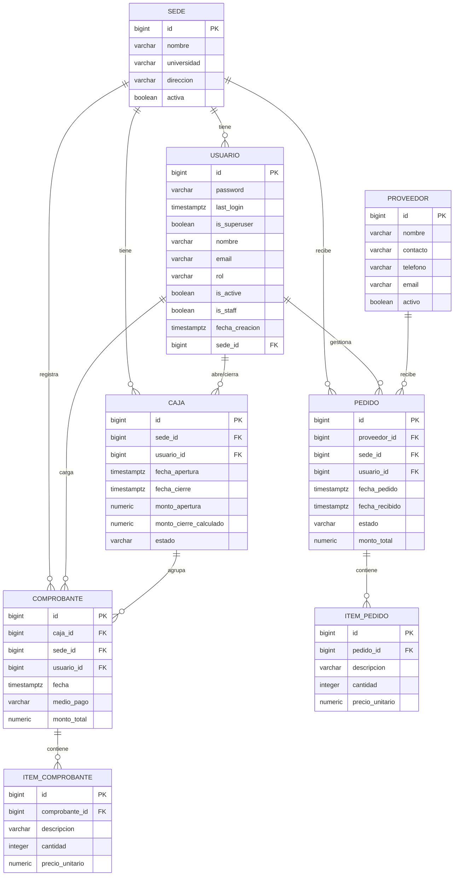

# Diseño de Base de Datos y Módulos

> **Versión actualizada con lo implementado.** Este documento nació como diseño previo al desarrollo; ahora describe la base de datos y los módulos **tal como quedaron construidos**. Todo lo que cambió respecto del diseño original está reunido en la [sección 1.7](#17-diferencias-respecto-del-diseño-original) y marcado con 🔄 donde aparece.

**Integrantes:** Nazareno Aranda, Julian Blanco Cortes
**Proyecto:** Sistema de gestión de caja y proveedores — cadena de comedores universitarios

---

## 1. Esquema de Base de Datos (relacional — PostgreSQL)

El script con la estructura real está en [`../database/schema.sql`](../database/schema.sql). Las tablas las crea Django con `python manage.py migrate`; el script es equivalente (se verificó cargándolo en una base vacía y comparándolo columna por columna con la que crea `migrate`).

### 1.1 Diagrama Entidad-Relación

### 1.2 Descripción de entidades

| Entidad | Descripción |
|---|---|
| **Sede** | Cada comedor de la cadena. Punto central que agrupa usuarios, cajas, comprobantes y pedidos. |
| **Usuario** | Personas que usan el sistema. Rol: `admin` (visión global, sin sede fija), `cajero` (**siempre** atado a una sede), `compras` (gestiona pedidos y proveedores; puede tener sede o ser central). |
| **Caja** | Apertura/cierre de caja de una sede en un turno o día. Agrupa los comprobantes emitidos en ese período. |
| **Comprobante** | Una venta registrada, asociada a una caja, sede y usuario (cajero). |
| **Item_Comprobante** | Detalle de productos vendidos dentro de un comprobante, para cuando se quiera desglosar la venta y no solo guardar el monto total. |
| **Proveedor** | Proveedores externos de insumos/alimentos. |
| **Pedido** | Un pedido realizado a un proveedor desde una sede. |
| **Item_Pedido** | Detalle de los productos/insumos incluidos en un pedido. |

### 1.3 Diccionario de datos

**Convenciones:** `PK` clave primaria, `FK` clave foránea, `NN` NOT NULL, `UQ` UNIQUE. Los importes usan `NUMERIC(12,2)` para evitar errores de redondeo. Las fechas son `TIMESTAMPTZ` (con zona horaria). Los valores permitidos de `estado` y `medio_pago` se controlan con `CHECK` en la base; el `rol` lo valida el backend (lista fija `admin` / `cajero` / `compras`). Las columnas con valor por defecto (estado inicial, fechas, `activo`) las completa el backend: en la base no tienen `DEFAULT`.

**sede**

| Campo | Tipo | Restricciones |
|---|---|---|
| id | BIGINT (identity) | PK |
| nombre | VARCHAR(150) | NN |
| universidad | VARCHAR(150) | NN (vacío si no se indica) 🔄 |
| direccion | VARCHAR(200) | NN (vacío si no se indica) 🔄 |
| activa | BOOLEAN | NN |

**usuario**

| Campo | Tipo | Restricciones |
|---|---|---|
| id | BIGINT (identity) | PK |
| password | VARCHAR(128) | NN — contraseña guardada con hash de Django 🔄 (antes `password_hash`) |
| last_login | TIMESTAMPTZ | Último ingreso 🔄 (nuevo) |
| is_superuser | BOOLEAN | NN 🔄 (nuevo, lo exige Django) |
| nombre | VARCHAR(150) | NN |
| email | VARCHAR(150) | NN, UQ (es el nombre de usuario para ingresar) |
| rol | VARCHAR(20) | NN: `admin`, `cajero`, `compras` |
| is_active | BOOLEAN | NN 🔄 (antes `activo`; baja lógica) |
| is_staff | BOOLEAN | NN 🔄 (nuevo; habilita el panel `/admin/`) |
| fecha_creacion | TIMESTAMPTZ | NN |
| sede_id | BIGINT | FK → sede(id), opcional (el cajero siempre tiene sede, lo valida el backend) |

**caja**

| Campo | Tipo | Restricciones |
|---|---|---|
| id | BIGINT (identity) | PK |
| fecha_apertura | TIMESTAMPTZ | NN |
| fecha_cierre | TIMESTAMPTZ | — (vacío mientras la caja está abierta) |
| monto_apertura | NUMERIC(12,2) | NN, CHECK ≥ 0 🔄 |
| monto_cierre_calculado | NUMERIC(12,2) | — (se calcula al cerrar: monto de apertura + total de todas las ventas de la caja) |
| estado | VARCHAR(20) | NN, CHECK: `abierta`, `cerrada` |
| sede_id | BIGINT | NN, FK → sede(id) |
| usuario_id | BIGINT | NN, FK → usuario(id) (cajero responsable) |

**comprobante**

| Campo | Tipo | Restricciones |
|---|---|---|
| id | BIGINT (identity) | PK |
| fecha | TIMESTAMPTZ | NN |
| medio_pago | VARCHAR(20) | NN, CHECK: `efectivo`, `tarjeta`, `transferencia`, `qr` |
| monto_total | NUMERIC(12,2) | NN, CHECK > 0 🔄 |
| caja_id | BIGINT | NN, FK → caja(id) |
| sede_id | BIGINT | NN, FK → sede(id) |
| usuario_id | BIGINT | NN, FK → usuario(id) |

**item_comprobante**

| Campo | Tipo | Restricciones |
|---|---|---|
| id | BIGINT (identity) | PK |
| descripcion | VARCHAR(150) | NN |
| cantidad | INTEGER | NN, CHECK ≥ 1 🔄 |
| precio_unitario | NUMERIC(12,2) | NN, CHECK ≥ 0 🔄 |
| comprobante_id | BIGINT | NN, FK → comprobante(id) (sin borrado en cascada 🔄) |

**proveedor**

| Campo | Tipo | Restricciones |
|---|---|---|
| id | BIGINT (identity) | PK |
| nombre | VARCHAR(150) | NN |
| contacto | VARCHAR(150) | NN (vacío si no se indica) 🔄 |
| telefono | VARCHAR(50) | NN (vacío si no se indica) 🔄 |
| email | VARCHAR(150) | NN (vacío si no se indica) 🔄 |
| activo | BOOLEAN | NN |

**pedido**

| Campo | Tipo | Restricciones |
|---|---|---|
| id | BIGINT (identity) | PK |
| fecha_pedido | TIMESTAMPTZ | NN |
| fecha_recibido | TIMESTAMPTZ | — (vacío hasta que llega el pedido) |
| estado | VARCHAR(20) | NN, CHECK: `pendiente`, `recibido`, `cancelado` |
| monto_total | NUMERIC(12,2) | — (suma de los ítems) |
| proveedor_id | BIGINT | NN, FK → proveedor(id) |
| sede_id | BIGINT | NN, FK → sede(id) |
| usuario_id | BIGINT | NN, FK → usuario(id) (quien cargó el pedido) |

**item_pedido**

| Campo | Tipo | Restricciones |
|---|---|---|
| id | BIGINT (identity) | PK |
| descripcion | VARCHAR(150) | NN |
| cantidad | INTEGER | NN, CHECK ≥ 1 🔄 |
| precio_unitario | NUMERIC(12,2) | NN, CHECK ≥ 0 🔄 |
| pedido_id | BIGINT | NN, FK → pedido(id) (sin borrado en cascada 🔄) |

### 1.4 Relaciones

| Relación | Cardinalidad | Clave foránea |
|---|---|---|
| Sede → Usuario | 1 a N | usuario.sede_id |
| Sede → Caja | 1 a N | caja.sede_id |
| Sede → Comprobante | 1 a N | comprobante.sede_id |
| Sede → Pedido | 1 a N | pedido.sede_id |
| Usuario → Caja | 1 a N | caja.usuario_id |
| Usuario → Comprobante | 1 a N | comprobante.usuario_id |
| Usuario → Pedido | 1 a N | pedido.usuario_id |
| Caja → Comprobante | 1 a N | comprobante.caja_id |
| Comprobante → Item_Comprobante | 1 a N | item_comprobante.comprobante_id |
| Proveedor → Pedido | 1 a N | pedido.proveedor_id |
| Pedido → Item_Pedido | 1 a N | item_pedido.pedido_id |

### 1.5 Índices principales

PostgreSQL crea solo un índice por cada clave primaria y por `usuario.email` (UNIQUE); Django agrega además uno por cada clave foránea. Los índices con nombre propio son los que se definieron a propósito:

| Índice | Tabla | Columnas | Para qué sirve |
|---|---|---|---|
| **una_caja_abierta_por_sede** 🔄 | caja | `sede_id` (único, solo donde `estado = 'abierta'`) | **Regla de negocio en la base:** impide que una sede tenga dos cajas abiertas, aunque dos cajeros intenten abrirla a la vez |
| idx_comprobante_sede_fecha | comprobante | sede_id, fecha | Listado y filtros de comprobantes por sede y fecha; panel consolidado |
| idx_pedido_proveedor | pedido | proveedor_id | Ver los pedidos de un proveedor |
| idx_pedido_sede_estado | pedido | sede_id, estado | Ver los pedidos pendientes de una sede |

Los índices `idx_usuario_sede`, `idx_caja_sede` e `idx_comprobante_caja` del diseño original ya no se declaran aparte: son los que Django crea solo sobre esas claves foráneas (con otro nombre). En `schema.sql` se escriben todos con nombre simple para que se vean.

### 1.6 Decisiones de diseño

- **Normalización:** el modelo cumple la 1FN (los productos de cada venta o pedido van en tablas de detalle, no en listas dentro de un campo) y la 2FN (todas las claves primarias son simples). Cumple la 3FN salvo una excepción intencional: `comprobante.sede_id` podría derivarse de `caja.sede_id`, pero se guarda igualmente para filtrar comprobantes por sede sin un `JOIN` extra en una consulta muy frecuente.
- **Bajas lógicas:** `sede`, `usuario` y `proveedor` tienen un campo `activa`/`activo` para dar de baja sin perder el historial de ventas y pedidos.
- **Sin borrado en cascada** 🔄: el diseño original preveía borrar los ítems junto con su comprobante o pedido. En la práctica el sistema **nunca borra** comprobantes ni pedidos (una venta registrada no se elimina), así que se quitó el `ON DELETE CASCADE`: la base no permite borrar registros que tengan datos asociados.
- **Reglas protegidas por la base:** además de validarlas el backend, las reglas más importantes están como restricciones (una sola caja abierta por sede, montos positivos, cantidades ≥ 1, estados y medios de pago válidos), de modo que un error de programación no pueda dejar datos inconsistentes.
- **Dinero como texto en la API:** los importes viajan en el JSON como cadenas (`"1250.50"`) para no perder precisión.
### 1.7 Diferencias respecto del diseño original

| # | Diseño original | Lo construido | Motivo |
|---|---|---|---|
| 1 | `usuario.password_hash VARCHAR(255)` | `usuario.password VARCHAR(128)` | Se usa el modelo de usuario de Django (`AbstractBaseUser`), que guarda la contraseña con hash en la columna `password`. |
| 2 | `usuario.activo` | `usuario.is_active` | Nombre que espera Django. Se sigue usando como baja lógica. |
| 3 | — | `usuario.last_login`, `is_superuser`, `is_staff` | Columnas que exige el modelo de usuario de Django; `is_staff` habilita el panel `/admin/`. Y además `django` crea las tablas `usuario_groups` y `usuario_user_permissions` (no se usan). |
| 4 | `TIMESTAMP` | `TIMESTAMPTZ` | Guardar la zona horaria evita errores al comparar fechas entre el servidor (UTC) y los usuarios (Argentina). |
| 5 | Textos opcionales con `NULL` (`universidad`, `direccion`, `contacto`, `telefono`, `email` de proveedor) | `NOT NULL`, con cadena vacía | Es la convención de Django para campos de texto: un solo valor para "sin dato" en lugar de dos (`NULL` y vacío). |
| 6 | `DEFAULT` en `estado`, fechas, `activo`, `cantidad`, `monto_apertura` | Sin `DEFAULT` en la base | Los valores iniciales los pone el backend al crear cada registro. |
| 7 | `BIGSERIAL` | `BIGINT GENERATED BY DEFAULT AS IDENTITY` | Es lo que usa Django en PostgreSQL moderno; funcionalmente equivale. |
| 8 | `ON DELETE CASCADE` en los ítems | Sin cascada | El sistema no borra comprobantes ni pedidos (ver 1.6). |
| 9 | Solo `CHECK` de `rol`, `estado`, `medio_pago` | Se quitó el `CHECK` de `rol` (lo valida el backend) y se agregaron `CHECK` de montos, cantidades y precios | Las reglas de negocio quedan protegidas también en la base. |
| 10 | — | Índice único parcial `una_caja_abierta_por_sede` | Garantiza una sola caja abierta por sede, incluso con operaciones simultáneas. |
| 11 | 6 índices propios | 4 índices propios + los de claves foráneas que crea Django | Ver 1.5. |
| 12 | 8 tablas | 8 tablas de negocio + tablas internas de Django y DRF (`authtoken_token`, `auth_*`, `django_*`) | Infraestructura de autenticación por token, sesiones del panel de administración y control de migraciones. No tienen datos del negocio. |

El **modelo conceptual no cambió**: las mismas 8 entidades, con las mismas relaciones y cardinalidades. Todos los cambios son de implementación.

---

## 2. Listado de módulos

> 🔄 **Estado actual: los 7 módulos del MVP están implementados, probados (54 pruebas automáticas) y desplegados.** De las funcionalidades opcionales se hizo solo la de *permisos por rol*; el resto quedó como trabajo futuro.

**Prioridad:** **Alta** = núcleo del MVP, sin esto el sistema no cumple su objetivo. **Media** = forma parte del MVP pero se construye al final porque depende de los demás. **Baja** = *nice to have*, solo si el tiempo lo permite.

Cada módulo se implementa como una app independiente de Django.

### 2.1 Módulos del MVP

| # | Módulo (app) | Descripción | Prioridad | Depende de |
|---|---|---|---|---|
| 1 | **Usuarios y Autenticación** (`usuarios`) | Login con token y usuarios con rol (admin, cajero, compras). Es la base de la que dependen los demás módulos. | Alta | — |
| 2 | **Sedes** (`sedes`) | Alta, baja y modificación de los comedores de la cadena. | Alta | Usuarios |
| 3 | **Proveedores** (`proveedores`) | Alta, baja y modificación de proveedores. Es independiente y puede desarrollarse en paralelo con Sedes. | Alta | — |
| 4 | **Caja** (`caja`) | Apertura y cierre de caja por sede, con cálculo automático de los totales del período. | Alta | Sedes, Usuarios |
| 5 | **Ventas / Comprobantes** (`ventas`) | Alta y listado de comprobantes de venta, con filtros por sede y fecha, siempre asociados a una caja abierta. | Alta | Caja |
| 6 | **Pedidos** (`pedidos`) | Alta y seguimiento de pedidos a proveedores por sede (pendiente / recibido / cancelado). | Alta | Proveedores, Sedes, Usuarios |
| 7 | **Panel Consolidado** (`dashboard`) | Vista para la administración con los totales de ventas y pedidos de todas las sedes. No tiene tablas propias: consulta los datos de Ventas y Pedidos. | Media | Ventas, Pedidos |

### 2.2 Funcionalidades opcionales (nice to have)

| Funcionalidad | Descripción | Prioridad |
|---|---|---|
| Reportes comparativos entre sedes | Comparar ventas y pedidos de las distintas sedes. | Baja — **parcial** 🔄: el panel consolidado muestra ventas y pedidos por sede lado a lado |
| Alertas de pedidos demorados | Avisar de pedidos pendientes hace demasiado tiempo. | Baja |
| Exportación a PDF/Excel | Exportar el cierre de caja. | Baja |
| Permisos por rol | Restringir qué puede hacer cada rol dentro de cada módulo. | Baja — **implementada** 🔄: ver 2.4 |

### 2.3 Orden de desarrollo (previsto y real)

1. Usuarios y Autenticación (base de todo lo demás)
2. Sedes y Proveedores (pueden hacerse en paralelo)
3. Caja
4. Ventas / Comprobantes
5. Pedidos
6. Panel Consolidado (cuando ya hay datos reales de Ventas y Pedidos para consolidar)
7. Funcionalidades opcionales, según el tiempo disponible

**Cómo fue en la práctica** 🔄: el orden se respetó. Primero el backend módulo por módulo (usuarios, sedes y proveedores, caja, ventas, pedidos, panel y despliegue), después el frontend en el mismo orden, y al final pruebas, documentación e informe.

### 2.4 Permisos por rol (lo que implementa el backend)

| Recurso | admin | compras | cajero |
|---|---|---|---|
| Usuarios | Todo | — | — |
| Sedes | Alta, modificación y baja | Solo consulta | Solo consulta |
| Proveedores | Alta, modificación y baja | Alta, modificación y baja | — |
| Cajas | Ver las de todas las sedes; abrir y cerrar | — | Abrir, cerrar y ver las de su sede |
| Comprobantes (ventas) | Ver los de todas las sedes; cargar | — | Cargar y ver los de su sede |
| Pedidos | Todo, en todas las sedes | Todo, en todas las sedes | — |
| Panel consolidado | Sí | — | — |

*(El detalle exacto de cada endpoint está en `backend/README.md`.)*
