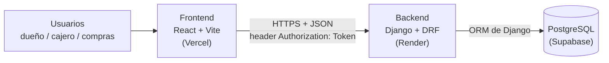
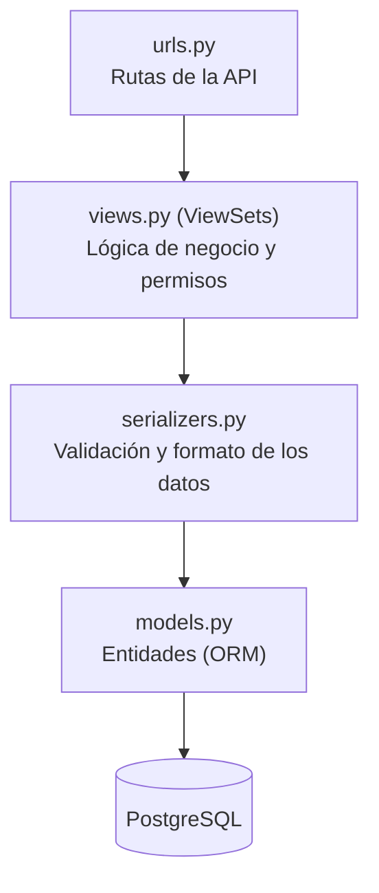

# Arquitectura del Proyecto

> **Versión actualizada con lo implementado.** Describe la arquitectura tal como quedó construida y desplegada. Los cambios respecto del diseño original están marcados con 🔄 y reunidos en la [sección 9](#9-diferencias-respecto-del-diseño-original).

**Integrantes:** Nazareno Aranda, Julian Blanco Cortes
**Proyecto:** Sistema de gestión de caja y proveedores — cadena de comedores universitarios

---

## 1. Visión general

El sistema sigue una arquitectura **cliente-servidor** con una **API REST** en el medio: una aplicación web (frontend) que consume una API (backend), la cual es la única que accede a la base de datos.



**Despliegue real** 🔄: tres servicios gratuitos independientes. El navegador descarga la aplicación React desde Vercel y, desde ahí, llama directamente a la API en Render (por eso el backend permite ese origen con CORS). Render se conecta a Supabase por el *Session pooler*, con SSL.

| Componente | Responsabilidad |
|---|---|
| **Frontend** | Interfaz que usan el cajero, el encargado de compras y la administración. No contiene reglas de negocio ni accede a la base de datos. |
| **Backend** | Expone la API, valida los datos, aplica las reglas de negocio (por ejemplo, calcular el cierre de caja) y controla el acceso según el rol. Atiende también el panel de administración de Django (`/admin/`). |
| **Base de datos** | Guarda la información de forma persistente y garantiza la integridad de las relaciones y de las reglas más importantes (por ejemplo, una sola caja abierta por sede). |

## 2. Estilo arquitectónico elegido

**Monolito modular con arquitectura en capas.**

- **Monolito:** el backend es una única aplicación Django, no varios servicios. Para un sistema que usarán pocas personas por sede, una arquitectura de microservicios sería sobreingeniería: más complejidad de despliegue y mantenimiento sin un beneficio real.
- **Modular:** el backend se divide en 7 apps independientes de Django, una por módulo funcional (ver [`02-Diseno-BD-Modulos.md`](./02-Diseno-BD-Modulos.md)). 🔄 Las 7 están implementadas.
- **En capas:** dentro de cada módulo el código se separa por responsabilidad (sección 3).
- **Relación con MVC:** Django sigue el patrón MTV (Model–Template–View), variante de MVC. Como la interfaz se construye aparte en React, el rol de la "vista" para el usuario lo cumple el frontend, que consume los datos en formato JSON.

## 3. Capas del backend

Cada módulo (app de Django) organiza su código en las mismas capas:



| Capa | Archivo | Responsabilidad |
|---|---|---|
| Enrutamiento | `urls.py` | Asocia cada dirección de la API con la vista que la atiende. |
| Lógica y control de acceso | `views.py` | Recibe la petición, verifica que el usuario esté autenticado y tenga permiso, y ejecuta la lógica (por ejemplo, el cálculo del cierre de caja). |
| Validación y transformación | `serializers.py` | Valida los datos que llegan y los convierte entre JSON y objetos. |
| Datos | `models.py` | Define las entidades, sus relaciones y las restricciones (se corresponde con el esquema de [`../database/schema.sql`](../database/schema.sql)). |
| Servicios 🔄 | `services.py` | Cálculos que no pertenecen a una vista (en `caja`: totales por medio de pago y efectivo esperado; en `dashboard`: las consultas del panel). Solo en los módulos que lo necesitan. |
| Permisos 🔄 | `usuarios/permissions.py` | Clases de permiso por rol que usan las vistas de todos los módulos (`EsAdmin`, `EsAdminOCompras`, `EsAdminOCajero`, `EsAdminOSoloLectura`). |
| Utilidades comunes 🔄 | `config/utilidades.py` | Funciones compartidas: formato del dinero y lectura de filtros de fecha. |

**Recorrido de una petición** (ejemplo: el cajero registra una venta):

1. El frontend envía un `POST` a la API con el comprobante en JSON y el token en el header `Authorization`.
2. `urls.py` dirige la petición a la vista de comprobantes.
3. La vista verifica el token, que el rol sea administración o cajero y que la caja de su sede esté abierta.
4. El serializer valida los datos (monto, medio de pago, etc.).
5. El modelo guarda el comprobante y sus ítems en PostgreSQL, dentro de una transacción.
6. La API responde con el comprobante creado, también en JSON.

## 4. Organización modular

| App de Django | Módulo |
|---|---|
| `usuarios` | Usuarios y Autenticación |
| `sedes` | Sedes |
| `proveedores` | Proveedores |
| `caja` | Caja |
| `ventas` | Ventas / Comprobantes |
| `pedidos` | Pedidos |
| `dashboard` | Panel Consolidado |

**Endpoints de la API** 🔄 (todos bajo `/api/`, con `Authorization: Token <clave>` salvo el login y el control de estado):

| Módulo | Endpoints |
|---|---|
| Estado del servicio | `GET health/` (sin autenticación; lo usa Render para verificar que el servicio vive) |
| `usuarios` | `POST auth/login/`, `POST auth/logout/`, `GET auth/me/`, ABM en `usuarios/` |
| `sedes` | ABM en `sedes/` |
| `proveedores` | ABM en `proveedores/` |
| `caja` | `cajas/`, `GET cajas/actual/`, `GET cajas/<id>/totales/`, `POST cajas/<id>/cerrar/` |
| `ventas` | `comprobantes/` (alta, listado con filtros y detalle) |
| `pedidos` | `pedidos/`, `POST pedidos/<id>/recibir/`, `POST pedidos/<id>/cancelar/` |
| `dashboard` | `GET dashboard/resumen/` |

- **Alta cohesión:** cada app contiene solo lo que corresponde a su responsabilidad (por ejemplo, `proveedores` no tiene lógica de caja).
- **Bajo acoplamiento:** las apps se relacionan entre sí por claves foráneas (ids). Las únicas dependencias de código son deliberadas y de un solo sentido: todas usan los permisos de `usuarios`, `ventas` usa la caja abierta, y `dashboard` consulta los modelos de `ventas` y `pedidos`.

**Seguridad y reglas de negocio** 🔄: la autenticación es por token (se crea al ingresar y se borra al salir o al modificar la cuenta del usuario); los mensajes de error del login no revelan si el email existe; un cajero solo accede a su sede; los cambios de estado de caja y pedidos usan bloqueo de fila (`select_for_update`) para que dos operaciones simultáneas no se pisen; y las contraseñas se guardan con hash.

## 5. Tecnologías definitivas

| Capa | Tecnología |
|---|---|
| Lenguaje backend | Python 3.13 |
| Framework backend | Django 5.2 + Django REST Framework 3.16 |
| Autenticación | Token Authentication de DRF |
| Base de datos | PostgreSQL (SQLite local si no se configura `DATABASE_URL`) |
| Conexión a la base | `psycopg2` + `dj-database-url` |
| Servidor de producción 🔄 | `gunicorn` + `whitenoise` (archivos estáticos del panel de administración) |
| Seguridad web 🔄 | `django-cors-headers` (CORS), variables de entorno con `python-dotenv` |
| Lenguaje y librería frontend | JavaScript + React 18 con Vite 7 y `react-router-dom` 7 |
| Pruebas 🔄 | Pruebas automáticas del backend con el ejecutor de Django (54 pruebas) |
| Hosting backend | Render |
| Hosting base de datos | Supabase (PostgreSQL gestionado) |
| Hosting frontend | Vercel |
| Control de versiones | Git + GitHub (repositorio único) |

Las versiones están fijadas por rangos en `backend/requirements.txt` y `frontend/package.json`. El procedimiento completo de despliegue está en [`04-Despliegue.md`](./04-Despliegue.md).

## 6. Justificación de las decisiones técnicas

| Decisión | Alternativa descartada | Motivo |
|---|---|---|
| Monolito modular | Microservicios | Sobreingeniería para el alcance del proyecto: pocos usuarios, un equipo de dos personas y plazo acotado. |
| Python + Django | Node/Express, Java/Spring Boot | El equipo ya conoce Python. Django incluye ORM, autenticación y un panel de administración que reducen mucho el trabajo del MVP. |
| API REST con DRF | Vistas de Django que generen HTML | Permite separar el frontend del backend y desplegarlos por separado, y que el frontend sea una interfaz ágil para cargar comprobantes. |
| PostgreSQL (relacional) | MongoDB (NoSQL) | Los datos tienen estructura fija y relaciones claras entre entidades, y se necesita integridad entre ellas. No hay grandes volúmenes ni estructuras cambiantes que justifiquen NoSQL. |
| Token Authentication | JWT, sesiones de Django | Frontend y backend están en dominios distintos, lo que complica las sesiones con cookies. JWT agrega complejidad (refresh tokens, expiración) sin aportar valor a este alcance. |
| React + Vite | Templates de Django | Interfaz más ágil para el uso diario del cajero y despliegue independiente del frontend. |
| Supabase para la base de datos | Base de datos gratuita de Render | La base gratuita de Render expira a los 30 días de creada, menos que la duración del proyecto. |
| Importes como texto en la API 🔄 | Números decimales en el JSON | Evita perder precisión por redondeo de punto flotante en el navegador. |
| Reglas críticas también en la base 🔄 | Validar solo en el backend | Una sola caja abierta por sede, montos positivos, etc., quedan garantizados aunque haya operaciones simultáneas o un error de programación. |
| Bajas lógicas 🔄 | Borrar registros | Se conserva el historial de ventas y pedidos. |

## 7. Estructura del repositorio

```
/backend              Aplicación Django + DRF
    config/           Configuración (settings, urls, utilidades, base de pruebas)
    usuarios/ sedes/ proveedores/ caja/ ventas/ pedidos/ dashboard/    Una app por módulo
    build.sh          Pasos de construcción en Render (instalar, migrar, estáticos)
    requirements.txt  Dependencias
/frontend             Aplicación React + Vite
    src/api/          Cliente de la API
    src/auth/         Sesión y rutas protegidas por rol
    src/components/   Componentes compartidos (menú, ABM, paginación…)
    src/pages/        Una pantalla por módulo (Login, Sedes, Proveedores, Caja, Ventas, Pedidos, Panel)
    vercel.json       Redirección para que las rutas funcionen al recargar
/database             schema.sql (estructura real), datos_ejemplo.sql y limpiar_datos_ejemplo.sql
/docs                 Propuesta, diseño de BD, arquitectura, despliegue, informe final, manual de uso y guion del video
README.md             Descripción general, tecnologías, integrantes y estado
```

🔄 En el diseño original `/backend` y `/frontend` contenían solo un `README.md`; ahora tienen la aplicación completa.

## 8. Conceptos de diseño aplicados

| Concepto | Dónde se aplica |
|---|---|
| Arquitectura en capas | Separación en urls / views / serializers / models (y services donde hace falta) dentro de cada módulo (sección 3). |
| Modularización | Una app de Django por módulo funcional (sección 4). |
| Alta cohesión | Cada app agrupa solo lo relacionado con su responsabilidad. |
| Bajo acoplamiento | Las apps se conectan solo por claves foráneas, no por lógica interna. |
| Separación de responsabilidades | Cada capa hace una sola cosa: los modelos no validan entrada, los serializers no controlan permisos. |
| Única responsabilidad | Cada tabla, módulo y capa tiene una única razón para cambiar. |
| Entidad-relación y normalización | Diagrama y decisiones en [`02-Diseno-BD-Modulos.md`](./02-Diseno-BD-Modulos.md). |
| Clean Architecture | No se aplica en su forma estricta: los modelos de Django están acoplados al ORM. Se toma su idea central (separar responsabilidades y organizar por dominio). |

## 9. Diferencias respecto del diseño original

| # | Diseño original | Lo construido |
|---|---|---|
| 1 | Capas: urls, views, serializers, models | Se sumó una capa `services.py` en `caja` y `dashboard` para los cálculos, y un módulo de permisos común. |
| 2 | Permisos por rol: funcionalidad opcional | Implementados desde el inicio, en todos los módulos, porque determinan qué ve cada usuario. |
| 3 | Autenticación por token | Igual, con cierre de sesión que borra el token y cierre automático de las sesiones de un usuario cuando se modifica su cuenta. |
| 4 | Despliegue: "Render, Supabase y Vercel" | Se resolvió el detalle: Session pooler de Supabase con SSL (la conexión directa de Supabase usa IPv6 y puede no ser alcanzable desde el hosting), `gunicorn` + `whitenoise`, CORS para el dominio de Vercel y `vercel.json` para las rutas del frontend. |
| 5 | Panel consolidado sin tablas propias | Se mantuvo: consulta ventas y pedidos. |
| 6 | Base de datos | Ajustes de implementación listados en [`02-Diseno-BD-Modulos.md`](./02-Diseno-BD-Modulos.md#17-diferencias-respecto-del-diseño-original); el modelo conceptual no cambió. |
| 7 | Frontend "sin reglas de negocio" | Se cumplió: el frontend solo muestra y envía datos; oculta las opciones según el rol por comodidad, pero **la seguridad la aplica siempre el backend**. |
| 8 | — | Se agregó una carga de datos de ejemplo (`database/datos_ejemplo.sql`) y un conjunto de pruebas automáticas que no estaban previstos en el diseño. |

La arquitectura general (cliente-servidor con API REST, monolito modular en capas, tres servicios de hosting) **se mantuvo tal como se diseñó**.
