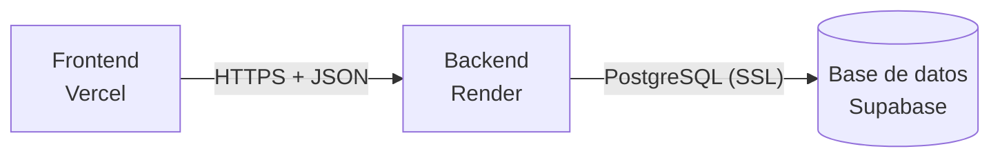

# Guía de despliegue

**Integrantes:** Nazareno Aranda, Julian Blanco Cortes
**Proyecto:** Sistema de gestión de caja y proveedores — cadena de comedores universitarios

La consigna de la cátedra exige que al menos un componente principal esté funcionando en un servicio en la nube. Este proyecto despliega sus tres componentes:

| Componente | Servicio | Estado de esta guía |
|---|---|---|
| Base de datos (PostgreSQL) | Supabase | **Documentada en este archivo** |
| Backend (Django + DRF) | Render | **Documentada en este archivo** |
| Frontend (React + Vite) | Vercel | **Documentada en este archivo** |



---

## 1. Base de datos en Supabase

### 1.1 Por qué Supabase

La base PostgreSQL gratuita de Render vence a los 30 días de creada, un plazo menor al que dura el proyecto. Supabase ofrece PostgreSQL gestionado en su plan gratuito, con un panel web para ver las tablas y los datos.

Django es el único que accede a la base, siempre con la conexión de PostgreSQL. El resto de las funciones de Supabase (autenticación, API automática, almacenamiento) **no se usan**.

### 1.2 Crear el proyecto

1. Crear una cuenta en [supabase.com](https://supabase.com) (se puede ingresar con GitHub).
2. **New project** y completar:
   - **Name:** por ejemplo `tfi-comedores`.
   - **Database password:** generar una contraseña larga y guardarla en un lugar seguro (un gestor de contraseñas o un mensaje privado entre los integrantes). Se muestra una sola vez y no se puede recuperar, solo restablecer.
   - **Region:** una cercana a Argentina; la de **South America (São Paulo)** reduce la latencia.
3. Esperar a que el proyecto termine de crearse (unos minutos).

### 1.3 Obtener la cadena de conexión

1. En el panel del proyecto, botón **Connect** (parte superior).
2. En la sección de cadena de conexión elegir el método **Session pooler** y copiar la URI.
3. Reemplazar `[YOUR-PASSWORD]` por la contraseña de la base.

La URI tiene este formato:

```
postgresql://postgres.<ref-del-proyecto>:<CONTRASEÑA>@aws-N-<región>.pooler.supabase.com:5432/postgres
```

**Por qué el *Session pooler* y no la conexión directa:** la conexión directa de Supabase usa direcciones IPv6, y muchos servicios y redes (entre ellos, posiblemente el hosting del backend) solo tienen IPv4. El *Session pooler* funciona por IPv4 y mantiene la conexión abierta, que es lo que Django necesita para aplicar migraciones. El *Transaction pooler* (puerto 6543) se descarta porque Django requiere ajustes extra para usarlo.

**Contraseñas con caracteres especiales:** dentro de una URL, los caracteres `@ : / # ? % &` rompen la cadena y hay que codificarlos (por ejemplo, `@` se escribe `%40`). Lo más simple es generar una contraseña solo con letras y números. Si ya tiene símbolos, se puede codificar con:

```
python -c "from urllib.parse import quote; print(quote('MI-CONTRASEÑA', safe=''))"
```

Al final de la URI se agrega `?sslmode=require` para forzar la conexión cifrada.

### 1.4 Configurar el proyecto para usar la base

La URI se guarda en la variable `DATABASE_URL` del archivo `.env` de la raíz del repositorio (copia de `.env.example`):

```
DATABASE_URL=postgresql://postgres.<ref>:<CONTRASEÑA>@aws-N-<región>.pooler.supabase.com:5432/postgres?sslmode=require
```

- El archivo `.env` **nunca se sube a GitHub**: está en `.gitignore`. La contraseña no debe aparecer en el repositorio, en capturas ni en mensajes públicos.
- Si `DATABASE_URL` queda vacío, el backend usa SQLite local. Sirve para desarrollar sin tocar la base online.
- Cada integrante tiene su propio `.env`; la URI se comparte por un canal privado.

### 1.5 Aplicar las migraciones

Con el entorno virtual activado, desde la carpeta `backend/`:

```
python manage.py migrate
python manage.py createsuperuser
```

`migrate` crea todas las tablas en Supabase a partir de los modelos de Django. `createsuperuser` crea el primer usuario administrador (email, nombre y contraseña).

Para comprobarlo, en el panel de Supabase: **Table Editor** (o **Database → Tables**), esquema `public`. Deben aparecer las tablas del sistema y las propias de Django:

| Tablas del sistema | Tablas de Django |
|---|---|
| `sede`, `usuario` (y, a medida que se desarrollan los módulos, `proveedor`, `caja`, `comprobante`, `pedido` y sus detalles) | `django_migrations`, `django_session`, `django_admin_log`, `django_content_type`, `auth_group`, `auth_permission`, `authtoken_token`, `usuario_groups`, `usuario_user_permissions` |

Cada vez que se agrega un módulo con tablas nuevas, se vuelve a correr `python manage.py migrate` con el `DATABASE_URL` correspondiente.

### 1.6 Verificar la conexión

Con el backend levantado (`python manage.py runserver`):

- `http://localhost:8000/api/health/` debe responder `{"status":"ok","database":"ok"}`.
- `http://localhost:8000/admin/` debe dejar ingresar con el superusuario creado, y los datos cargados deben verse también en el **Table Editor** de Supabase.

### 1.7 Seguridad: desactivar la Data API

Supabase genera automáticamente una API REST (la *Data API*) para las tablas del esquema `public`. En los proyectos existentes, las tablas nuevas de ese esquema reciben permisos automáticos para esa API, y las tablas creadas fuera del panel de Supabase (como las que crean las migraciones de Django) no tienen activada la seguridad por filas (RLS). Supabase está cambiando este comportamiento para que la exposición sea opcional, pero según cuándo se haya creado el proyecto puede seguir activa. Si lo estuviera, tablas como `usuario` (que guarda las contraseñas cifradas) quedarían accesibles desde Internet.

Como este proyecto no usa esa API, se **desactiva por completo**:

1. En el panel: **Integrations → Data API**.
2. Poner **Enable Data API** en apagado.

Con la Data API desactivada, ningún endpoint REST de Supabase responde, y Django sigue funcionando porque se conecta directamente a PostgreSQL. Los nombres de los menús pueden cambiar con el tiempo; la referencia vigente es la guía oficial: [Hardening the Data API](https://supabase.com/docs/guides/database/hardening-data-api).

### 1.8 Problemas frecuentes

| Síntoma | Causa probable | Solución |
|---|---|---|
| `Network is unreachable` o no resuelve el host | Se usó la conexión directa (IPv6) desde una red IPv4 | Usar la cadena del *Session pooler* |
| `password authentication failed` | Contraseña incorrecta o con caracteres especiales sin codificar | Revisar o codificar la contraseña; si se perdió, restablecerla en **Project Settings → Database** |
| `Tenant or user not found` | El usuario no tiene el formato del pooler | El usuario debe ser `postgres.<ref-del-proyecto>`, no `postgres` |
| Error de SSL | Falta cifrar la conexión | Agregar `?sslmode=require` al final de la URI |
| Tiempo de espera agotado | El proyecto está pausado | Entrar al panel de Supabase y restaurarlo (ver 1.9) |
| `/api/health/` responde `"database":"error"` | Falla la conexión | Revisar `DATABASE_URL` en `.env` y reiniciar el servidor |

### 1.9 Limitaciones del plan gratuito

- Los proyectos del plan gratuito **se pausan tras un período de inactividad** (a la fecha de esta guía, una semana). Se reactivan desde el panel de Supabase con la opción de restaurar el proyecto, y los datos se conservan.
- **Antes de la defensa oral y de grabar el video**, entrar al panel y confirmar que el proyecto está activo.
- Las condiciones del plan pueden cambiar: revisar las vigentes en la [documentación de Supabase](https://supabase.com/docs/guides/database/connecting-to-postgres).

---

## 2. Backend en Render

### 2.1 Qué se despliega

Se despliega la carpeta `backend/` del repositorio como un **Web Service** de Render, conectado al repositorio de GitHub: cada vez que se sube un cambio a `main` dentro de `backend/`, Render vuelve a construir y a publicar el servicio automáticamente. El backend se conecta a la base de Supabase (sección 1) con la variable `DATABASE_URL`.

Archivos del repositorio que lo hacen posible:

| Archivo | Para qué sirve |
|---|---|
| `backend/build.sh` | Script de construcción: instala las dependencias, junta los archivos estáticos del panel de administración y aplica las migraciones en Supabase. |
| `backend/requirements.txt` | Dependencias (incluye `gunicorn`, el servidor de producción, y `whitenoise`, que sirve los estáticos). |
| `backend/config/settings.py` | Lee todo de variables de entorno y, en Render, autoriza solo el dominio del servicio (`RENDER_EXTERNAL_HOSTNAME`). Con `DEBUG=False` las cookies viajan solo por https. |
| `.gitattributes` (raíz) | Obliga a que `build.sh` tenga fin de línea LF, que es lo que entiende Render. |

### 2.2 Crear el servicio

1. Crear una cuenta en [render.com](https://render.com) (se puede ingresar con GitHub) y autorizar el acceso al repositorio `tfi-comedores-universitarios`.
2. **New → Web Service** y elegir el repositorio.
3. Completar:

| Campo | Valor |
|---|---|
| **Name** | `tfi-comedores-api` (define la dirección pública: `https://tfi-comedores-api.onrender.com`; si el nombre está tomado, Render agrega un sufijo) |
| **Language** | Python 3 |
| **Branch** | `main` |
| **Region** | La más cercana a la base de datos entre las disponibles (por ejemplo, Virginia o Ohio) |
| **Root Directory** | `backend` |
| **Build Command** | `bash build.sh` |
| **Start Command** | `gunicorn config.wsgi:application --workers 2 --timeout 60` |
| **Instance Type** | Free |

   (Se usa `bash build.sh` y no `./build.sh` porque los archivos subidos desde la web de GitHub pierden el permiso de ejecución.)

4. En **Advanced → Health Check Path** escribir `/api/health/`. Render consulta esa dirección para saber si el servicio arrancó; el backend responde `{"status":"ok","database":"ok"}` cuando también anda la base.

### 2.3 Variables de entorno

En la misma pantalla (o después, en **Environment**), agregar:

| Variable | Valor | Notas |
|---|---|---|
| `PYTHON_VERSION` | `3.13.5` | Versión completa, con el número final. Sin esto Render usa su versión por defecto, más nueva que la que se probó. |
| `DEBUG` | `False` | Siempre falso en producción. |
| `SECRET_KEY` | una clave larga y aleatoria | Generar una **distinta** a la de desarrollo con `python -c "from django.core.management.utils import get_random_secret_key as g; print(g())"`. |
| `DATABASE_URL` | la URI del *Session pooler* de Supabase | Con `?sslmode=require` al final y la contraseña codificada si tiene símbolos (ver 1.3). |
| `CORS_ALLOWED_ORIGINS` | `http://localhost:5173` por ahora | Cuando se despliegue el frontend (sección 3) se cambia por su URL de Vercel, sin barra final. |

No hace falta `ALLOWED_HOSTS` ni `CSRF_TRUSTED_ORIGINS`: el dominio de Render se agrega solo. Ninguno de estos valores se escribe en el repositorio: se cargan solo en el panel de Render.

### 2.4 Primer despliegue

1. **Create Web Service**. Render ejecuta `build.sh` (se ve en la pestaña **Logs**): instala las dependencias y aplica las migraciones sobre Supabase. Tarda unos minutos.
2. Cuando el estado pasa a **Live**, abrir `https://<nombre-del-servicio>.onrender.com/api/health/`: tiene que mostrar `{"status":"ok","database":"ok"}`.
3. Abrir `https://<nombre-del-servicio>.onrender.com/admin/` e ingresar con el superusuario. No hay que crear otro: **ya existe en Supabase** (se creó en 1.5, y el backend desplegado usa la misma base). La pantalla debe verse con estilos.
4. Probar el login de la API:

```
curl -X POST https://<nombre-del-servicio>.onrender.com/api/auth/login/ \
  -H "Content-Type: application/json" \
  -d '{"email": "<email del superusuario>", "password": "<contraseña>"}'
```

Debe devolver un token. Con él se puede consultar, por ejemplo, `GET /api/dashboard/resumen/` con el header `Authorization: Token <token>`.

**URL del backend desplegado:** `COMPLETAR-CON-LA-URL-REAL` (se pega acá apenas el servicio esté en estado Live).

### 2.5 Actualizar el backend

Cada commit a `main` que cambie algo dentro de `backend/` dispara un nuevo despliegue (un cambio en `docs/` o en `frontend/` no lo dispara). Si el cambio agrega tablas, `build.sh` ya corre `migrate` contra Supabase: no hace falta hacerlo a mano. Un despliegue con error no reemplaza al que está funcionando.

### 2.6 Problemas frecuentes

| Síntoma | Causa probable | Solución |
|---|---|---|
| El build falla con `SECRET_KEY` | Falta la variable de entorno | Cargarla en **Environment** y volver a desplegar |
| El build falla en `migrate` con un error de conexión | `DATABASE_URL` mal copiada, o proyecto de Supabase pausado | Ver la tabla de 1.8 y restaurar el proyecto en Supabase |
| `bash: build.sh: No such file` | **Root Directory** vacío | Poner `backend` en **Root Directory** |
| El deploy falla al instalar `psycopg2-binary` | Versión de Python demasiado nueva | Confirmar `PYTHON_VERSION` = `3.13.5` |
| `Bad Request (400)` al abrir la URL | El dominio no está autorizado | Verificar que el servicio sea un Web Service de Render (define `RENDER_EXTERNAL_HOSTNAME`) o agregar el dominio a `ALLOWED_HOSTS` |
| El panel de administración se ve sin estilos | No se ejecutó `collectstatic` | Revisar que el **Build Command** sea `bash build.sh` |
| El health check falla y el deploy se cancela | La base no responde | Ver `DATABASE_URL` y el estado del proyecto de Supabase |
| El frontend recibe un error de CORS | Su dirección no está en `CORS_ALLOWED_ORIGINS` | Agregar la URL de Vercel (con `https://`, sin barra final) y esperar el reinicio |

### 2.7 Limitaciones del plan gratuito

- Si el servicio **no recibe tráfico durante unos 15 minutos, Render lo suspende**; la próxima petición lo reactiva y la primera respuesta puede tardar cerca de un minuto. Es normal y no es un error.
- El plan gratuito tiene un tope de horas por mes (750 horas gratuitas por workspace a la fecha de esta guía) y no incluye acceso por consola (*Shell*) al servicio; por eso el superusuario se crea desde la compu apuntando a Supabase (ver 1.5).
- **Antes de la defensa y de grabar el video:** abrir `/api/health/` unos minutos antes para "despertar" el servicio, y confirmar que el proyecto de Supabase está activo.
- Las condiciones pueden cambiar: revisar las vigentes en la [documentación de Render](https://render.com/docs/deploy-django).

---

## 3. Frontend en Vercel

### 3.1 Qué se despliega

Se despliega la carpeta `frontend/` del repositorio como sitio estático: Vercel ejecuta `npm run build` (Vite) y publica la carpeta `dist/`. Como es una aplicación de una sola página, el archivo `frontend/vercel.json` le indica a Vercel que cualquier dirección interna (por ejemplo `/ventas`) devuelva la aplicación; sin eso, al recargar la página en una dirección que no sea la raíz daría error 404.

La aplicación necesita saber dónde está el backend. Esa dirección se define con la variable `VITE_API_URL`, que Vite **incorpora al construir** el sitio (no se lee en tiempo de ejecución): si se cambia, hay que volver a desplegar.

### 3.2 Crear el proyecto

Requisito: el backend ya desplegado en Render (sección 2) y su URL a mano.

1. Crear una cuenta en [vercel.com](https://vercel.com) (se puede ingresar con GitHub; el plan *Hobby* alcanza) y autorizar el acceso al repositorio `tfi-comedores-universitarios`.
2. **Add New… → Project** y, en la lista de repositorios, **Import** el del proyecto.
3. En la pantalla de configuración:

| Campo | Valor |
|---|---|
| **Project Name** | `tfi-comedores` (define la dirección: `https://tfi-comedores.vercel.app`; si está tomado, Vercel propone otra) |
| **Framework Preset** | Vite (lo detecta solo) |
| **Root Directory** | `frontend` (botón **Edit**) |
| **Build Command / Output Directory** | los que propone Vercel (`npm run build` y `dist`) |
| **Environment Variables** | `VITE_API_URL` = la URL del backend en Render, con `https://` y **sin barra final** (por ejemplo `https://tfi-comedores-api.onrender.com`) |

4. **Deploy**. Tarda un par de minutos. Cuando termina, Vercel muestra la dirección pública del sitio.

La versión de Node que usa Vercel (por defecto, la última LTS) es compatible con el proyecto (`engines` en `frontend/package.json`); no hace falta cambiarla.

**URL del frontend desplegado:** `COMPLETAR-CON-LA-URL-REAL` (se pega acá apenas el sitio esté publicado).

### 3.3 Autorizar el frontend en el backend (CORS)

El navegador solo permite que la página llame a la API si el backend la autoriza. En el panel de **Render → servicio del backend → Environment**, cambiar la variable `CORS_ALLOWED_ORIGINS` por la dirección del frontend, con `https://` y **sin barra final**:

```
CORS_ALLOWED_ORIGINS=https://tfi-comedores.vercel.app
```

(Si hace falta seguir probando desde la compu, se agrega también `http://localhost:5173`, separado por coma.) Render reinicia el servicio solo al guardar. Si no se hace este paso, el login falla con un error de red / CORS en la consola del navegador.

### 3.4 Actualizar el frontend

Cada commit a `main` que cambie algo dentro de `frontend/` dispara un nuevo despliegue automático. Cada despliegue tiene además su propia dirección de vista previa, que **no** está autorizada por CORS (solo funciona la dirección principal del proyecto). Si se cambia `VITE_API_URL` en **Settings → Environment Variables**, hay que hacer **Redeploy** para que tome el valor nuevo.

### 3.5 Problemas frecuentes

| Síntoma | Causa probable | Solución |
|---|---|---|
| El login muestra "No se pudo conectar con el servidor" | `VITE_API_URL` mal escrita, o falta autorizar el frontend en el backend | Revisar la variable (con `https://`, sin barra final), volver a desplegar y revisar `CORS_ALLOWED_ORIGINS` (3.3) |
| Error de CORS en la consola del navegador | La dirección del frontend no está en `CORS_ALLOWED_ORIGINS`, o está con barra final | Corregirla en Render (3.3) |
| Al recargar una pantalla (por ejemplo `/ventas`) aparece 404 | Falta `frontend/vercel.json` o el **Root Directory** no es `frontend` | Verificar ambos y volver a desplegar |
| Pantalla en blanco | El build falló o se desplegó otra carpeta | Revisar **Deployments → Build Logs** y el **Root Directory** |
| Cambié la variable y no pasa nada | Vite incorpora la variable al construir | **Redeploy** del último despliegue |
| La primera carga tarda casi un minuto | El backend gratuito de Render estaba dormido | Normal: la pantalla de login lo avisa; esperar y no cerrar la página |

### 3.6 Limitaciones del plan gratuito

- El plan *Hobby* de Vercel es para uso personal y no comercial, adecuado para este trabajo académico. Los límites y condiciones pueden cambiar: revisar los vigentes en la [documentación de Vercel](https://vercel.com/docs/plans/hobby).
- El sitio en sí no se "duerme" (son archivos estáticos); lo que puede estar dormido es el backend (2.7) o la base (1.9). **Antes de la defensa y del video**, abrir la aplicación unos minutos antes y verificar que se pueda ingresar.

---

## 4. Prueba del flujo completo en línea

Con los tres componentes desplegados, se recorre el flujo principal del sistema con los usuarios de ejemplo (contraseña `Demo-1234`; datos cargados con `database/datos_ejemplo.sql`). Cada paso se marca al verificarlo:

| Paso | Quién | Qué se hace | Resultado esperado |
|---|---|---|---|
| 1 | — | Abrir la dirección del frontend | Aparece el login; sin sesión, cualquier dirección interna también lleva al login |
| 2 | Cajero (`cajero.ciencias@comedores.test`) | Ingresar → **Caja** → abrir la caja con un monto inicial | La caja queda abierta y se muestra su resumen |
| 3 | Cajero | **Ventas** → cargar una venta con productos | Aparece primero en el listado, con el total correcto |
| 4 | Cajero | **Caja** → **Cerrar caja** | Se muestra el efectivo esperado (apertura + ventas en efectivo) y el cierre queda en el historial; ya no se pueden cargar ventas en esa caja |
| 5 | Compras (`compras@comedores.test`) | **Pedidos** → registrar un pedido a un proveedor | Queda *Pendiente*; al marcarlo como *Recibido* se guarda la fecha de recepción |
| 6 | Administración (`admin@comedores.test`) | **Panel** | Los totales de ventas y de pedidos incluyen lo cargado en los pasos 3 y 5, por sede y consolidados |
| 7 | Cajero | Intentar entrar a **Panel** o **Proveedores** (por la dirección) | "Sin acceso": cada rol ve solo lo suyo |

Esta misma secuencia se verificó de forma automática con un navegador real contra una versión de producción (frontend compilado + backend con `gunicorn` y `DEBUG=False`) antes del despliegue. Falta repetirla sobre las direcciones reales y anotar acá la fecha en que se hizo: `COMPLETAR (fecha de la prueba en línea)`.
