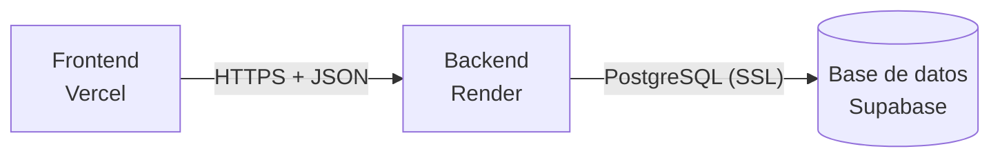

# Guía de despliegue

**Integrantes:** Nazareno Aranda, Julian Blanco Cortes
**Proyecto:** Sistema de gestión de caja y proveedores — cadena de comedores universitarios

La consigna de la cátedra exige que al menos un componente principal esté funcionando en un servicio en la nube. Este proyecto despliega sus tres componentes:

| Componente | Servicio | Estado de esta guía |
|---|---|---|
| Base de datos (PostgreSQL) | Supabase | **Documentada en este archivo** |
| Backend (Django + DRF) | Render | Pendiente (se documenta al desplegarlo) |
| Frontend (React + Vite) | Vercel | Pendiente (se documenta al desplegarlo) |



---

## 1. Base de datos en Supabase

### 1.1 Por qué Supabase

La base PostgreSQL gratuita de Render vence a los 30 días de creada, un plazo menor al que dura el proyecto. Supabase ofrece PostgreSQL gestionado en su plan gratuito, con un panel web para ver las tablas y los datos.

Django es el único que accede a la base, siempre con la conexión de PostgreSQL. El resto de las funciones de Supabase (autenticación, API automática, almacenamiento) **no se usan**.

### 1.2 Crear el proyecto

1. Crear una cuenta en [supabase.com](https://supabase.com) (se puede ingresar con GitHub).
2. **New project** y completar:
   - **Name:** por ejemplo `tfi-comedores`.
   - **Database password:** generar una contraseña larga y guardarla en un lugar seguro (un gestor de contraseñas o un mensaje privado entre los integrantes). Se muestra una sola vez y no se puede recuperar, solo restablecer.
   - **Region:** una cercana a Argentina; la de **South America (São Paulo)** reduce la latencia.
3. Esperar a que el proyecto termine de crearse (unos minutos).

### 1.3 Obtener la cadena de conexión

1. En el panel del proyecto, botón **Connect** (parte superior).
2. En la sección de cadena de conexión elegir el método **Session pooler** y copiar la URI.
3. Reemplazar `[YOUR-PASSWORD]` por la contraseña de la base.

La URI tiene este formato:

```
postgresql://postgres.<ref-del-proyecto>:<CONTRASEÑA>@aws-N-<región>.pooler.supabase.com:5432/postgres
```

**Por qué el *Session pooler* y no la conexión directa:** la conexión directa de Supabase usa direcciones IPv6, y muchos servicios y redes (entre ellos, posiblemente el hosting del backend) solo tienen IPv4. El *Session pooler* funciona por IPv4 y mantiene la conexión abierta, que es lo que Django necesita para aplicar migraciones. El *Transaction pooler* (puerto 6543) se descarta porque Django requiere ajustes extra para usarlo.

**Contraseñas con caracteres especiales:** dentro de una URL, los caracteres `@ : / # ? % &` rompen la cadena y hay que codificarlos (por ejemplo, `@` se escribe `%40`). Lo más simple es generar una contraseña solo con letras y números. Si ya tiene símbolos, se puede codificar con:

```
python -c "from urllib.parse import quote; print(quote('MI-CONTRASEÑA', safe=''))"
```

Al final de la URI se agrega `?sslmode=require` para forzar la conexión cifrada.

### 1.4 Configurar el proyecto para usar la base

La URI se guarda en la variable `DATABASE_URL` del archivo `.env` de la raíz del repositorio (copia de `.env.example`):

```
DATABASE_URL=postgresql://postgres.<ref>:<CONTRASEÑA>@aws-N-<región>.pooler.supabase.com:5432/postgres?sslmode=require
```

- El archivo `.env` **nunca se sube a GitHub**: está en `.gitignore`. La contraseña no debe aparecer en el repositorio, en capturas ni en mensajes públicos.
- Si `DATABASE_URL` queda vacío, el backend usa SQLite local. Sirve para desarrollar sin tocar la base online.
- Cada integrante tiene su propio `.env`; la URI se comparte por un canal privado.

### 1.5 Aplicar las migraciones

Con el entorno virtual activado, desde la carpeta `backend/`:

```
python manage.py migrate
python manage.py createsuperuser
```

`migrate` crea todas las tablas en Supabase a partir de los modelos de Django. `createsuperuser` crea el primer usuario administrador (email, nombre y contraseña).

Para comprobarlo, en el panel de Supabase: **Table Editor** (o **Database → Tables**), esquema `public`. Deben aparecer las tablas del sistema y las propias de Django:

| Tablas del sistema | Tablas de Django |
|---|---|
| `sede`, `usuario` (y, a medida que se desarrollan los módulos, `proveedor`, `caja`, `comprobante`, `pedido` y sus detalles) | `django_migrations`, `django_session`, `django_admin_log`, `django_content_type`, `auth_group`, `auth_permission`, `authtoken_token`, `usuario_groups`, `usuario_user_permissions` |

Cada vez que se agrega un módulo con tablas nuevas, se vuelve a correr `python manage.py migrate` con el `DATABASE_URL` correspondiente.

### 1.6 Verificar la conexión

Con el backend levantado (`python manage.py runserver`):

- `http://localhost:8000/api/health/` debe responder `{"status":"ok","database":"ok"}`.
- `http://localhost:8000/admin/` debe dejar ingresar con el superusuario creado, y los datos cargados deben verse también en el **Table Editor** de Supabase.

### 1.7 Seguridad: desactivar la Data API

Supabase genera automáticamente una API REST (la *Data API*) para las tablas del esquema `public`. En los proyectos existentes, las tablas nuevas de ese esquema reciben permisos automáticos para esa API, y las tablas creadas fuera del panel de Supabase (como las que crean las migraciones de Django) no tienen activada la seguridad por filas (RLS). Supabase está cambiando este comportamiento para que la exposición sea opcional, pero según cuándo se haya creado el proyecto puede seguir activa. Si lo estuviera, tablas como `usuario` (que guarda las contraseñas cifradas) quedarían accesibles desde Internet.

Como este proyecto no usa esa API, se **desactiva por completo**:

1. En el panel: **Integrations → Data API**.
2. Poner **Enable Data API** en apagado.

Con la Data API desactivada, ningún endpoint REST de Supabase responde, y Django sigue funcionando porque se conecta directamente a PostgreSQL. Los nombres de los menús pueden cambiar con el tiempo; la referencia vigente es la guía oficial: [Hardening the Data API](https://supabase.com/docs/guides/database/hardening-data-api).

### 1.8 Problemas frecuentes

| Síntoma | Causa probable | Solución |
|---|---|---|
| `Network is unreachable` o no resuelve el host | Se usó la conexión directa (IPv6) desde una red IPv4 | Usar la cadena del *Session pooler* |
| `password authentication failed` | Contraseña incorrecta o con caracteres especiales sin codificar | Revisar o codificar la contraseña; si se perdió, restablecerla en **Project Settings → Database** |
| `Tenant or user not found` | El usuario no tiene el formato del pooler | El usuario debe ser `postgres.<ref-del-proyecto>`, no `postgres` |
| Error de SSL | Falta cifrar la conexión | Agregar `?sslmode=require` al final de la URI |
| Tiempo de espera agotado | El proyecto está pausado | Entrar al panel de Supabase y restaurarlo (ver 1.9) |
| `/api/health/` responde `"database":"error"` | Falla la conexión | Revisar `DATABASE_URL` en `.env` y reiniciar el servidor |

### 1.9 Limitaciones del plan gratuito

- Los proyectos del plan gratuito **se pausan tras un período de inactividad** (a la fecha de esta guía, una semana). Se reactivan desde el panel de Supabase con la opción de restaurar el proyecto, y los datos se conservan.
- **Antes de la defensa oral y de grabar el video**, entrar al panel y confirmar que el proyecto está activo.
- Las condiciones del plan pueden cambiar: revisar las vigentes en la [documentación de Supabase](https://supabase.com/docs/guides/database/connecting-to-postgres).

---

## 2. Backend en Render

*Pendiente. Se documenta al desplegarlo (24/10).*

## 3. Frontend en Vercel

*Pendiente. Se documenta al desplegarlo (31/10).*
