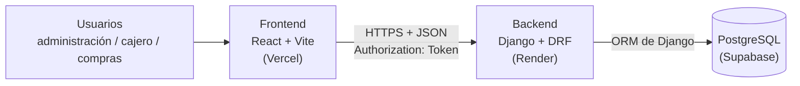
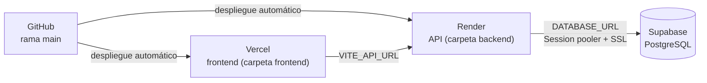

# Informe Final — Sistema de gestión de caja y proveedores

**Trabajo Final Integrador — Tecnicatura Universitaria en Programación (UTN)**
**Integrantes:** Nazareno Aranda, Julian Blanco Cortes
**Proyecto:** Sistema de gestión de caja y proveedores para una cadena de comedores universitarios (caso simulado, inventiva propia)

| | |
|---|---|
| **Repositorio** | https://github.com/NazarenoAranda/tfi-comedores-universitarios |
| **Aplicación en línea (frontend)** | `COMPLETAR-URL-DE-VERCEL` |
| **API en línea (backend)** | `COMPLETAR-URL-DE-RENDER`/api/health/ |
| **Video de presentación** | `COMPLETAR-LINK-DEL-VIDEO` |

> **Índice.** Primera parte: 1. Problema · 2. Solución · 3. Arquitectura · 4. Módulos · 5. Tecnologías · 6. Despliegue.
> Segunda parte: 7. Resultados · 8. Dificultades · 9. Aprendizajes · 10. Trabajo futuro · 11. Conclusión.

---

# Primera parte

## 1. El problema

### 1.1 Contexto

Se plantea el caso de una **cadena de comedores universitarios**: una administración central que gestiona varios comedores (sedes) dentro del ámbito de una o más universidades. Cada sede tiene un encargado de caja que registra las ventas del día; además, un encargado de compras gestiona los pedidos a los proveedores (insumos, alimentos, bebidas).

| Actor | Qué hace | Qué necesita |
|---|---|---|
| Administración (dueño) | Supervisa todas las sedes | Ver ventas y pedidos de todas las sedes juntos, sin esperar reportes manuales |
| Encargado de caja (por sede) | Registra las ventas del día | Cargar comprobantes rápido y cerrar la caja sin hacer cuentas a mano |
| Encargado de compras | Pide mercadería a los proveedores | Saber qué se pidió, a quién y en qué estado está cada pedido |

### 1.2 Situación de partida

Hoy la información se lleva con **planillas de Excel sueltas y anotaciones en papel**, sin un criterio común entre sedes. Cada comedor maneja sus datos de forma aislada.

### 1.3 Enunciado

> El personal de una cadena de comedores universitarios —encargados de caja en cada sede, encargado de compras y la administración central— registra las ventas diarias y los pedidos a proveedores con Excel y papel, sin un criterio centralizado entre sedes. Esto hace que armar el cierre de caja lleve mucho tiempo y que no haya forma rápida de consolidar la información de todas las sedes.

### 1.4 Por qué una solución de software

Una planilla, aunque esté bien armada, depende de la disciplina de cada persona en cada sede y no ofrece una vista central. Un sistema con una interfaz simple reduce el esfuerzo del registro diario, **calcula solo el cierre de caja** y **consolida automáticamente** los datos de todas las sedes.

### 1.5 Alcance

**Dentro del alcance (MVP):** comprobantes de venta por sede, cierre de caja con cálculo automático, proveedores, pedidos con seguimiento de estado, panel consolidado para la administración y permisos según el rol.

**Fuera del alcance:** facturación electrónica o integración con AFIP, control de stock, aplicación móvil nativa y pagos en línea. El sistema **registra** el medio de pago; no procesa cobros.

La propuesta original completa está en [`01-Propuesta.md`](./01-Propuesta.md).

## 2. La solución

Se construyó una **aplicación web** con tres partes: una interfaz que se usa desde el navegador (en la computadora o el celular), una API que concentra las reglas del negocio y una base de datos que guarda todo en un solo lugar. Cada persona entra con su correo y su contraseña y **ve solo lo que le corresponde según su rol**:

| Rol | Qué puede hacer en el sistema |
|---|---|
| **Administración** | Todo: gestiona sedes, usuarios (por el panel `/admin/` o la API) y proveedores; ve las cajas, ventas y pedidos de todas las sedes; consulta el panel consolidado. |
| **Cajero** | Abre y cierra la caja **de su sede** y registra ventas. Solo ve datos de su sede. |
| **Compras** | Gestiona proveedores y pedidos (cargar, marcar como recibido, cancelar). |

**El flujo de trabajo**, de punta a punta:

1. La administración da de alta las **sedes** y los **proveedores** desde la aplicación, y los **usuarios** desde el panel de administración (`/admin/`).
2. Al empezar el turno, el cajero **abre la caja** indicando el efectivo inicial.
3. Durante el día registra cada **venta** (comprobante) con su medio de pago, con o sin detalle de ítems; el sistema calcula el total.
4. Al terminar, el cajero **cierra la caja**: el sistema muestra el total por medio de pago y el efectivo que debería haber, sin cuentas manuales.
5. El encargado de compras carga **pedidos** a los proveedores y los marca como recibidos o cancelados.
6. La administración mira el **panel consolidado**: ventas y pedidos de cada sede y del total.

**Reglas del negocio que garantiza el sistema** (y que verifican las pruebas automáticas):

- Una sede no puede tener dos cajas abiertas a la vez, ni siquiera si dos cajeros intentan abrirla al mismo tiempo.
- No se puede registrar una venta si la caja está cerrada.
- Un cajero no puede ver ni modificar datos de otra sede.
- Una caja cerrada o un pedido ya recibido o cancelado no vuelven a cambiar.
- Nada se borra: las sedes, usuarios y proveedores se **dan de baja** (de forma lógica), para conservar el historial.
- Los importes se manejan sin errores de redondeo.

## 3. Arquitectura

La arquitectura es **cliente-servidor con una API REST**: el navegador carga una aplicación React que se comunica con una API (Django + Django REST Framework), y solo la API accede a la base de datos PostgreSQL.

**Estilo: monolito modular en capas.** El backend es una única aplicación, dividida en siete apps de Django (una por módulo) y, dentro de cada una, en capas con una responsabilidad cada una:

| Capa | Archivo | Responsabilidad |
|---|---|---|
| Rutas | `urls.py` | Qué dirección de la API atiende cada vista |
| Vistas | `views.py` | Verifica permisos y ejecuta la lógica de cada operación |
| Serializadores | `serializers.py` | Valida los datos que llegan y los convierte a JSON |
| Modelos | `models.py` | Entidades, relaciones y restricciones |
| Servicios | `services.py` | Cálculos reutilizables (totales de caja, consultas del panel) |

**Decisiones principales:** se eligió un monolito (y no microservicios) porque el sistema lo usarán pocas personas por sede y el equipo es de dos; Django, porque trae autenticación, ORM y panel de administración; PostgreSQL, porque los datos son estructurados y relacionales; y autenticación por token, porque frontend y backend viven en dominios distintos. Las alternativas descartadas y sus motivos están en [`03-Arquitectura.md`](./03-Arquitectura.md).

**Base de datos.** Son 8 tablas de negocio: `sede`, `usuario`, `caja`, `comprobante`, `item_comprobante`, `proveedor`, `pedido` e `item_pedido`. Parte de las reglas están también como restricciones de la base (un índice único parcial garantiza una sola caja abierta por sede; los montos deben ser positivos; las cantidades, al menos 1). El diagrama entidad-relación, el diccionario de datos y la lista de diferencias entre el diseño y lo construido están en [`02-Diseno-BD-Modulos.md`](./02-Diseno-BD-Modulos.md) y en [`../database/schema.sql`](../database/schema.sql).

## 4. Módulos

El sistema se organiza en siete módulos. Los siete están implementados, probados y desplegados.

| # | Módulo | Qué hace | Quién lo usa |
|---|---|---|---|
| 1 | **Usuarios y autenticación** | Ingreso con correo y contraseña, token de sesión, cierre de sesión y alta, modificación y baja de usuarios con rol | Todos (la gestión de usuarios, solo administración, por la API y el panel `/admin/`) |
| 2 | **Sedes** | Alta, modificación y baja de comedores | Administración (los demás roles consultan) |
| 3 | **Proveedores** | Alta, modificación y baja de proveedores | Administración y compras |
| 4 | **Caja** | Apertura y cierre de caja por sede; totales por medio de pago y efectivo esperado | Cajeros y administración |
| 5 | **Ventas / comprobantes** | Registro de ventas con o sin ítems, siempre dentro de una caja abierta; listado con filtros por sede, fecha y medio de pago | Cajeros y administración |
| 6 | **Pedidos** | Pedidos a proveedores con ítems y estados (pendiente, recibido, cancelado) | Compras y administración |
| 7 | **Panel consolidado** | Totales de ventas y pedidos de todas las sedes y por sede, con filtro de fechas | Administración |

**Interfaz.** El frontend tiene una pantalla por módulo: ingreso, inicio, sedes, proveedores, caja, ventas, pedidos y panel. El menú muestra solo las secciones permitidas para el rol, las rutas están protegidas, y la aplicación se adapta al celular. Las capturas de pantalla de cada paso están en el [Manual de uso](./06-Manual-de-Uso.md).

> **Sobre la seguridad.** La interfaz oculta las opciones que un rol no puede usar, pero eso es solo comodidad: **la seguridad la aplica siempre el backend**. Aunque alguien intentara llamar a la API directamente, un cajero no puede ver otra sede ni un encargado de compras puede cerrar una caja.

## 5. Tecnologías

| Capa | Tecnología | Por qué |
|---|---|---|
| Lenguaje del backend | Python 3.13 | Lo conoce el equipo |
| Framework | Django 5.2 + Django REST Framework 3.16 | ORM, validación, autenticación y panel de administración incluidos |
| Autenticación | Token Authentication de DRF | Simple y adecuada para un frontend en otro dominio |
| Base de datos | PostgreSQL en Supabase | Datos relacionales con integridad; la base gratuita de Render vence a los 30 días, menos que la duración del proyecto |
| Servidor de producción | gunicorn + whitenoise | Servidor WSGI estándar y archivos estáticos del panel de administración |
| Seguridad web | django-cors-headers, variables de entorno | Permite solo el dominio del frontend; las claves nunca van en el código |
| Frontend | React 18 + Vite 7 + react-router-dom 7 | Interfaz ágil para el uso diario y despliegue independiente |
| Pruebas | Ejecutor de pruebas de Django (54 pruebas) | Comprueban las reglas del negocio y los permisos |
| Hosting | Render (API), Supabase (base), Vercel (frontend) | Planes gratuitos y despliegue desde GitHub |
| Control de versiones | Git + GitHub | Repositorio único, con commits por funcionalidad |

## 6. Despliegue

El sistema está publicado en tres servicios gratuitos que se conectan entre sí y se actualizan solos con cada cambio en la rama `main` de GitHub:

| Servicio | Qué aloja | Puntos clave de la configuración |
|---|---|---|
| **Supabase** | La base PostgreSQL | Conexión por *Session pooler* con SSL (la conexión directa usa IPv6 y puede no ser alcanzable desde el hosting); *Data API* desactivada, porque Django se conecta directo a PostgreSQL y no hace falta exponer una API pública de la base |
| **Render** | La API Django | Directorio raíz `backend`; construcción con `bash build.sh` (instala dependencias, junta los estáticos y aplica las migraciones); arranque con `gunicorn`; verificación de estado en `/api/health/`; clave secreta, `DEBUG=False`, `DATABASE_URL` y orígenes permitidos como variables de entorno |
| **Vercel** | El frontend React | Directorio raíz `frontend`; variable `VITE_API_URL` apuntando a la API; `vercel.json` con la regla que hace que las rutas de la aplicación funcionen al recargar la página |

**Detalles que importan:**

- **CORS:** el backend solo acepta pedidos desde la dirección del frontend en Vercel, que se carga en `CORS_ALLOWED_ORIGINS`.
- **Variables de entorno:** `SECRET_KEY`, `DATABASE_URL` y demás valores sensibles viven en el panel de cada servicio y en un archivo `.env` local que **no se sube** al repositorio.
- **Plan gratuito de Render:** el servicio se "duerme" tras un rato sin uso y el primer pedido puede tardar cerca de un minuto en responder; después anda con normalidad.
- **Primer usuario:** el administrador inicial se crea con un comando (`createsuperuser`); a partir de ahí, los demás usuarios se crean desde el panel de administración de Django (`/admin/`) o desde la API (`/api/usuarios/`); la interfaz React no incluye una pantalla de usuarios. Para demostraciones se puede cargar `database/datos_ejemplo.sql`.

La guía paso a paso (con todas las variables y la lista de verificación) está en [`04-Despliegue.md`](./04-Despliegue.md).

---

# Segunda parte

## 7. Resultados

### 7.1 Objetivos cumplidos

| Objetivo de la propuesta | Estado | Cómo se verifica |
|---|---|---|
| Registro de comprobantes de venta por sede | Cumplido | Pantalla *Ventas*; pruebas del módulo `ventas` (17) |
| Listado y consulta con filtros por sede y fecha | Cumplido (y también por caja, usuario y medio de pago) | Pruebas de filtros |
| Cierre de caja con cálculo automático | Cumplido | Pantalla *Caja*; pruebas del módulo `caja` (10) |
| Alta y listado de proveedores | Cumplido (con modificación y baja) | Pantalla *Proveedores* |
| Alta y seguimiento de pedidos | Cumplido (pendiente, recibido, cancelado) | Pantalla *Pedidos*; pruebas (10) |
| Panel consolidado para la administración | Cumplido | Pantalla *Panel*; pruebas (6) |
| Permisos diferenciados por rol *(opcional)* | Cumplido | Pruebas de permisos en todos los módulos |
| Reportes comparativos entre sedes *(opcional)* | Parcial | El panel muestra las sedes lado a lado |
| Alertas de pedidos demorados *(opcional)* | No realizado | Ver trabajo futuro |
| Exportación del cierre de caja a PDF/Excel *(opcional)* | No realizado | Ver trabajo futuro |

**El MVP completo está terminado y desplegado.** De las cuatro funcionalidades opcionales se hizo una completa (permisos por rol) y una parcial.

### 7.2 Calidad del software

- **54 pruebas automáticas** del backend (usuarios 11, caja 10, ventas 17, pedidos 10, panel 6). Se ejecutan en menos de dos segundos con `python manage.py test` y pasan tanto sobre SQLite como sobre PostgreSQL.
- **Las pruebas detectan errores de verdad:** se rompieron a propósito dos reglas (permitir ventas con la caja cerrada e ignorar el monto de apertura en el cierre) y las pruebas correspondientes fallaron, como corresponde.
- **Recorrido completo en un navegador real:** se automatizó, con un navegador, el flujo de punta a punta (ingreso, apertura de caja, venta, cierre, pedido y panel) contra una versión de producción local (frontend compilado y backend con `gunicorn` y `DEBUG=False`), incluyendo la vista en pantalla de celular y el comportamiento de cada rol.
- **Base de datos:** el script `schema.sql` se verificó contra la base que crean las migraciones y son idénticos; los datos de ejemplo cargan sin errores.
- **Prueba en el sistema publicado:** se repitió el recorrido sobre las direcciones reales el `COMPLETAR (fecha)`, con resultado `COMPLETAR (sin problemas / problemas encontrados)`.

### 7.3 El sistema en funcionamiento

Las capturas de pantalla del recorrido completo (ingreso, apertura de caja, carga de una venta, cierre, proveedores, pedidos, sedes y panel por sede) están en el [Manual de uso](./06-Manual-de-Uso.md); el guion del video, en [`07-Guion-Video.md`](./07-Guion-Video.md).

### 7.4 Cumplimiento del problema original

El dolor central era el **tiempo perdido armando el cierre de caja** y la **falta de una vista consolidada**. Ambos quedan resueltos por diseño: el cierre se calcula solo, con un clic, a partir de las ventas ya cargadas, y el panel suma todas las sedes sin intervención manual. No se midieron tiempos reales con usuarios, porque el caso es simulado: la mejora es de diseño, no un resultado estadístico.

### 7.5 Tamaño del proyecto

| Dato | Valor |
|---|---|
| Módulos del backend (apps de Django) | 7 |
| Tablas de negocio | 8 |
| Pantallas del frontend | 8 (más la de página no encontrada) |
| Pruebas automáticas | 54 |
| Documentos | Propuesta, diseño de BD y módulos, arquitectura, despliegue, informe, manual de uso y guion del video |

## 8. Dificultades encontradas

> *Esta sección recoge los problemas técnicos reales del proceso. Conviene que cada integrante la revise y agregue, con sus palabras, las dificultades que vivió en primera persona (por ejemplo, de coordinación o de tiempos).*

| Dificultad | Cómo se resolvió |
|---|---|
| **Conectar Render con Supabase.** La conexión directa de Supabase usa direcciones IPv6, que no siempre son alcanzables desde el hosting. | Se usó el *Session pooler* (IPv4), con `sslmode=require`. |
| **Riesgo de dos cajas abiertas a la vez.** Si dos cajeros abren la caja de una sede al mismo tiempo, la validación del backend podría pasar en ambos casos. | Se agregó una restricción en la base de datos (índice único parcial) y el backend traduce ese rechazo en un mensaje claro. |
| **Cambios de estado simultáneos.** Dos personas cerrando una caja o recibiendo un pedido a la vez podrían pisarse. | Se bloquea la fila durante la operación (`select_for_update`) dentro de una transacción. |
| **Errores de redondeo con el dinero.** Los números decimales de JavaScript pierden precisión. | Los importes se guardan como `NUMERIC(12,2)` y viajan como texto; el frontend los formatea con el formato argentino. |
| **CORS y variables de entorno en producción.** Sin agregar el dominio de Vercel a los orígenes permitidos, el navegador bloquea las llamadas del frontend a la API. | Se documentó el orden de despliegue: primero la API, después el frontend, y por último cargar su dirección en `CORS_ALLOWED_ORIGINS`. |
| **Rutas del frontend al recargar.** Sin una regla especial, al actualizar la página en una ruta interna Vercel devuelve error 404. | Se agregó `vercel.json` con la regla de reescritura para aplicaciones de una sola página. |
| **Sesión tras cerrar sesión.** Al volver a ingresar, la aplicación llevaba a la última página visitada en vez de al inicio. | Se distingue el cierre de sesión voluntario del vencimiento de la sesión. |
| **Pantallas de celular.** Las filas de ítems se desbordaban en pantallas angostas. | Se rehicieron con columnas flexibles y campos que ocupan el ancho disponible. |
| **Subir archivos a GitHub desde la web.** La subida por navegador no admite archivos vacíos ni conserva permisos de ejecución, y reemplaza archivos del mismo nombre. | Se ajustó la estructura de los archivos y se escribió, para cada entrega, una guía de subida con el mensaje de commit. |
| **Plan gratuito de Render.** El servicio se duerme y el primer pedido tarda. | Se documentó el comportamiento y la recomendación de "despertar" la API antes de una demostración. |
| **Coordinar el trabajo entre dos personas.** Dividir módulos y respetar el cronograma. | Se trabajó con un cronograma por semanas, un commit por funcionalidad y un reparto alternado de los días. |

## 9. Aprendizajes

**Técnicos**

- **Las reglas importantes deben protegerse en más de una capa.** Validar en el backend no alcanza cuando hay operaciones simultáneas: una restricción en la base de datos es la última línea de defensa.
- **El frontend no es una barrera de seguridad.** Ocultar un botón mejora la experiencia; los permisos reales se aplican siempre en la API.
- **Un monolito modular alcanza.** Separar por módulos y por capas dio orden y facilitó repartir el trabajo sin la complejidad de los microservicios.
- **El despliegue es parte del desarrollo.** Variables de entorno, CORS, conexión a la base y comandos de construcción se descubren recién al publicar; conviene hacerlo temprano y probar en condiciones parecidas a producción (con `DEBUG=False`).
- **Las pruebas automáticas dan confianza para cambiar.** Poder correr 54 pruebas en un par de segundos permitió ajustar reglas sin miedo a romper otras. Además, una prueba que nunca falla no prueba nada: por eso se rompió el código a propósito para comprobarlas.
- **El dinero se trata con tipos exactos**, nunca con números de punto flotante.
- **Documentar mientras se construye** evita reconstruir de memoria; el esquema final difiere del diseño inicial y registrar esas diferencias es parte del trabajo.

**De trabajo en equipo y de proceso**

- Un **cronograma con commits pequeños y frecuentes** deja un historial claro y reparte la carga.
- Revisar el trabajo del otro antes de integrarlo encuentra errores que uno no ve en lo propio.
- Escribir primero la propuesta, el diseño de la base y la arquitectura ahorró retrabajo: casi todo el modelo conceptual sobrevivió intacto hasta el final.

> *Se sugiere que cada integrante agregue acá un párrafo propio sobre lo que más aprendió.*

## 10. Trabajo futuro

| Mejora | Qué aportaría |
|---|---|
| **Exportación del cierre de caja a PDF y Excel** | Entregar el cierre a contaduría sin copiar datos a mano |
| **Alertas de pedidos demorados** | Avisar de pedidos pendientes hace demasiado tiempo |
| **Reportes comparativos** con gráficos y rangos de fechas | Análisis de tendencias entre sedes |
| **Control de stock** vinculado a pedidos y ventas | Saber qué hay en cada comedor |
| **Catálogo de productos** con precios | Cargar ventas más rápido, sin escribir la descripción cada vez |
| **Anulación de comprobantes** con auditoría | Corregir errores sin borrar historial |
| **Diferencias de caja** (efectivo contado vs. calculado) | Detectar faltantes o sobrantes al cerrar |
| **Recuperación de contraseña** por correo y vencimiento de sesiones | Mayor seguridad y autonomía de los usuarios |
| **Aplicación instalable (PWA) y modo sin conexión** | Seguir vendiendo si se corta internet |
| **Pruebas automáticas del frontend** | Cubrir también la interfaz |
| **Pasar a un plan pago de hosting** | Evitar que la API se duerma y mejorar el rendimiento |
| **Facturación electrónica** (AFIP) | Cumplimiento fiscal para un uso real |

## 11. Conclusión

Se logró el objetivo central: **un sistema web completo, funcionando en línea, que reemplaza las planillas y el papel** por un flujo único de caja, ventas, proveedores y pedidos, con una vista consolidada para la administración y permisos por rol. El proyecto cubrió todo el ciclo de desarrollo: relevamiento del problema, diseño de la base de datos y de la arquitectura, construcción del backend y del frontend, pruebas, despliegue en tres servicios y documentación.

Más allá del producto, el proyecto dejó la experiencia de **llevar una idea desde la propuesta hasta una aplicación publicada**, tomando decisiones, equivocándose y corrigiendo, y trabajando de a dos con un cronograma. El resultado es una base sólida sobre la que se pueden construir las mejoras de la sección 10.

---

## Anexo — Documentación del proyecto

| Documento | Contenido |
|---|---|
| [`01-Propuesta.md`](./01-Propuesta.md) | Problema, alcance, viabilidad |
| [`02-Diseno-BD-Modulos.md`](./02-Diseno-BD-Modulos.md) | Diseño de la base de datos, módulos y diferencias con el diseño original |
| [`03-Arquitectura.md`](./03-Arquitectura.md) | Arquitectura, capas, tecnologías y justificación |
| [`04-Despliegue.md`](./04-Despliegue.md) | Guía de despliegue paso a paso |
| [`06-Manual-de-Uso.md`](./06-Manual-de-Uso.md) | Manual de uso con capturas |
| [`07-Guion-Video.md`](./07-Guion-Video.md) | Guion del video de presentación |
| [`../database/schema.sql`](../database/schema.sql) | Estructura real de la base de datos |
| [`../backend/README.md`](../backend/README.md) | Instalación, API y pruebas del backend |
