# Manual de uso

**Integrantes:** Nazareno Aranda, Julian Blanco Cortes
**Proyecto:** Sistema de gestión de caja y proveedores — cadena de comedores universitarios

Este manual explica cómo usar la aplicación web, paso a paso y según el rol de cada persona. No hace falta saber de informática.

- **Dirección de la aplicación:** `COMPLETAR-CON-LA-URL-DEL-FRONTEND` (la de Vercel, ver [`04-Despliegue.md`](./04-Despliegue.md))
- **Cómo se usa:** desde cualquier navegador (computadora, tablet o celular), con conexión a Internet.

> **Aviso sobre la primera carga:** la aplicación usa servicios gratuitos que se "duermen" si pasa un rato sin uso. La primera vez del día, el ingreso puede tardar hasta un minuto. Es normal: la pantalla lo avisa. Hay que esperar sin cerrar la página.

> Las capturas de este manual son de la aplicación con los datos de ejemplo (`database/datos_ejemplo.sql`); las pantallas son las mismas que en la versión en línea.

---

## 1. Qué hace el sistema

Reemplaza las planillas y los papeles con los que se llevaba el negocio. Permite:

- **Registrar las ventas** de cada comedor (comprobantes con medio de pago y, si se quiere, el detalle de productos).
- **Abrir y cerrar la caja** de cada sede, con el total de lo vendido y el efectivo que tiene que haber.
- **Registrar los pedidos a proveedores** y seguirlos hasta que se reciben.
- **Ver todo junto**: la administración tiene un panel con las ventas y los pedidos de cada sede y de toda la cadena.

## 2. Roles: quién puede hacer qué

Cada persona tiene un usuario con un rol. La aplicación solo le muestra lo que le corresponde.

| | Administración | Cajero | Compras |
|---|---|---|---|
| Sedes | Ver y modificar | Ver | Ver |
| Proveedores | Ver y modificar | — | Ver y modificar |
| Caja (abrir y cerrar) | Todas las sedes | Solo su sede | — |
| Ventas (cargar y consultar) | Todas las sedes | Solo su sede | — |
| Pedidos a proveedores | Sí | — | Sí |
| Panel consolidado | Sí | — | — |

Las altas de usuarios y la configuración avanzada las hace la administración desde el panel de administración del sistema (ver la sección 8).

## 3. Ingresar y salir

1. Abrir la dirección de la aplicación.
2. Escribir el **email** y la **contraseña** y tocar **Ingresar**.
3. Para salir, tocar **Salir** (arriba a la derecha). Conviene hacerlo en computadoras compartidas.

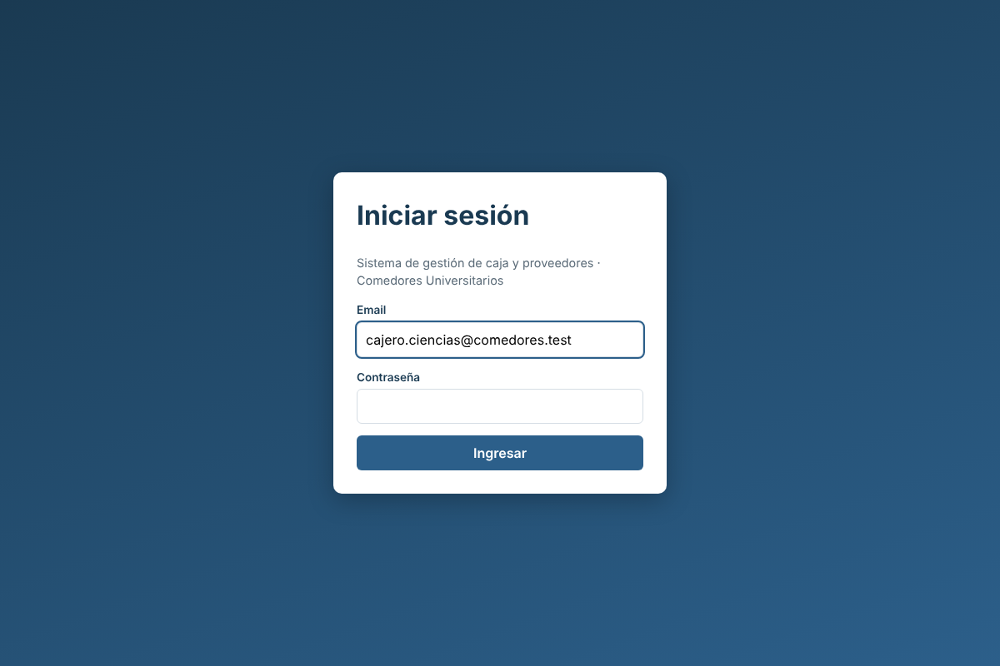

Si el email o la contraseña son incorrectos, la pantalla lo avisa. Si una persona se olvidó la contraseña, la administración se la restablece.

Al ingresar se ve la pantalla de **Inicio**, con el nombre, el rol y la sede de la persona, y accesos a lo que puede usar. El menú de arriba siempre muestra solo las pantallas de su rol.

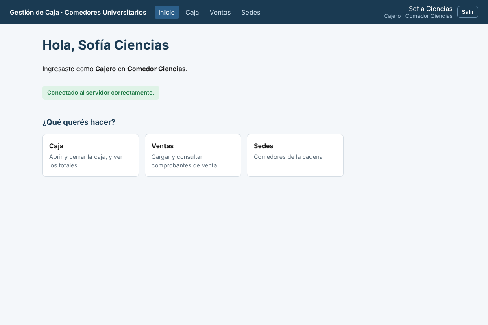

---

## 4. Cajeros

### 4.1 Abrir la caja (al empezar el día)

1. Entrar a **Caja**.
2. Escribir el **monto de apertura**: el efectivo con el que arranca la caja (puede ser 0).
3. Tocar **Abrir caja**.

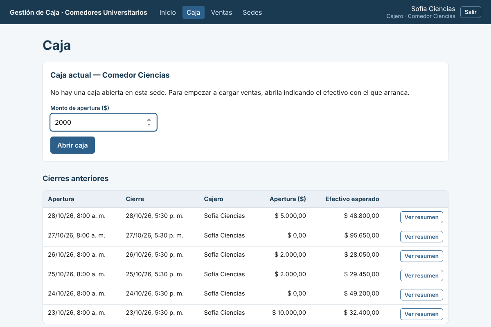

Cada sede puede tener **una sola caja abierta** a la vez. Sin caja abierta no se pueden cargar ventas.

### 4.2 Cargar una venta

1. Entrar a **Ventas**.
2. Elegir el **medio de pago**: efectivo, tarjeta, transferencia o QR.
3. Cargar el importe de una de estas dos formas:
   - **Detallando los productos:** escribir el producto, la cantidad y el precio unitario. Con **+ Agregar producto** se suman más líneas. El total se calcula solo.
   - **Solo el monto total:** para cuando no hace falta el detalle.
4. Tocar **Registrar venta**.

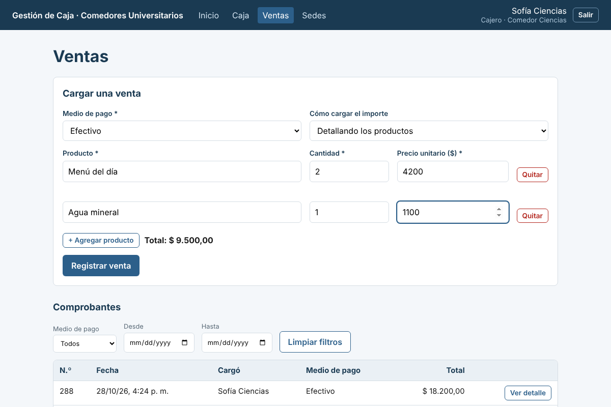

La venta aparece arriba en el listado de **Comprobantes**. Con **Ver detalle** se ven los productos. El listado se puede filtrar por medio de pago y por fechas. Los comprobantes **no se pueden modificar ni borrar**: son el respaldo del cierre de caja. Si hubo un error, se avisa a la administración.

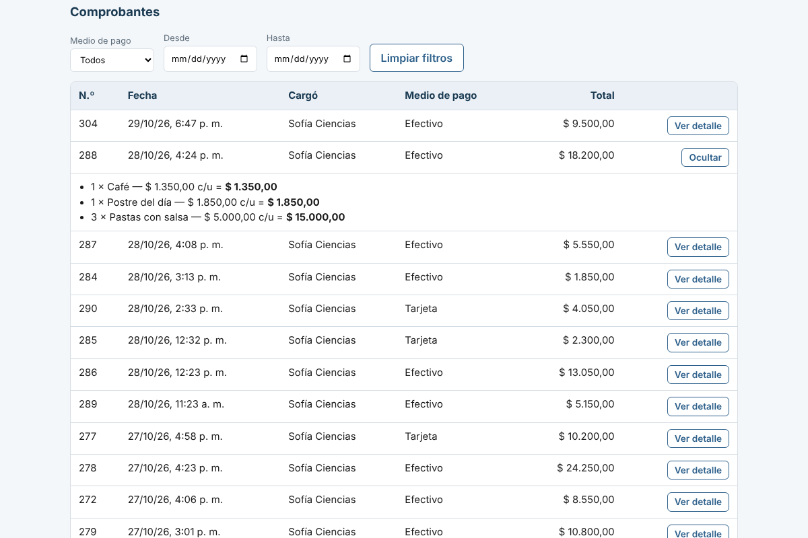

### 4.3 Ver la caja durante el día

En **Caja** se ve en cualquier momento cuántos comprobantes hay, el total vendido, el desglose por medio de pago y el **efectivo esperado**.

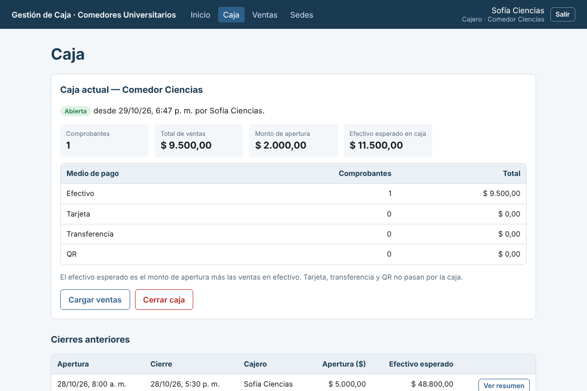

> **Efectivo esperado** = monto de apertura + ventas cobradas en efectivo. Es lo que debería haber en la caja física. Las ventas con tarjeta, transferencia o QR no pasan por la caja.

### 4.4 Cerrar la caja (al terminar el día)

1. En **Caja**, tocar **Cerrar caja** y confirmar.
2. Se muestra el resumen del cierre y el efectivo que tiene que haber. Contar el efectivo real y compararlo con ese número.

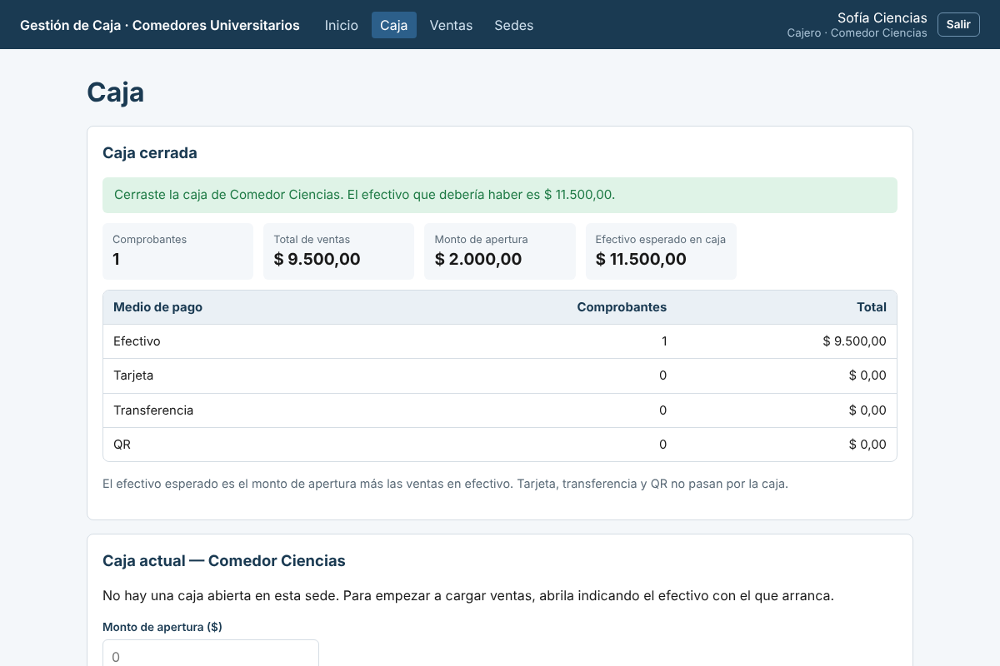

Una vez cerrada, no se pueden cargar más ventas en esa caja ni volver a abrirla; al día siguiente se abre una nueva. Abajo, en **Cierres anteriores**, queda el historial: con **Ver resumen** se consulta cualquier cierre pasado.

---

## 5. Compras

### 5.1 Proveedores

En **Proveedores** se ven los proveedores activos. Se puede buscar por texto y cambiar entre *Activos*, *Dados de baja* y *Todos*.

- **+ Nuevo proveedor:** completar al menos el nombre (contacto, teléfono y email son opcionales) y **Guardar**.
- **Modificar:** corrige los datos.
- **Dar de baja:** el proveedor deja de aparecer en los pedidos nuevos, pero **no se borra**: se conserva su historial. Con **Reactivar** vuelve a estar disponible.

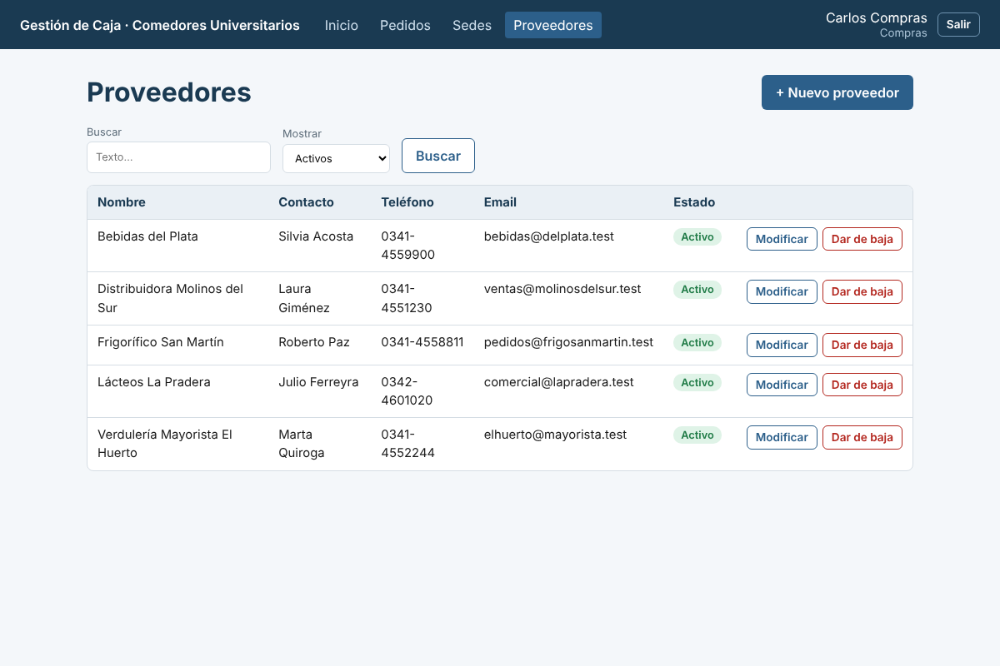

### 5.2 Pedidos a proveedores

En **Pedidos** se ven todos los pedidos, del más nuevo al más viejo, con su estado:

| Estado | Significa |
|---|---|
| **Pendiente** | Se pidió y todavía no llegó |
| **Recibido** | Llegó la mercadería (queda registrada la fecha) |
| **Cancelado** | Se anuló el pedido |

Se puede filtrar por estado, proveedor, sede y fechas.

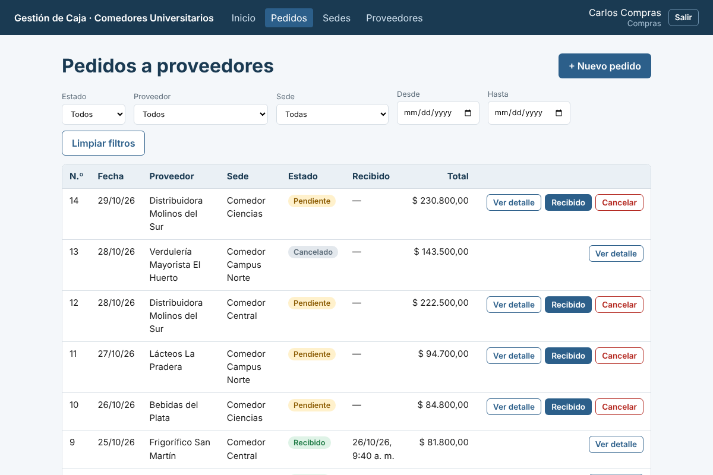

**Para cargar un pedido nuevo:**

1. Tocar **+ Nuevo pedido**.
2. Elegir el **proveedor** y la **sede** que recibe la mercadería.
3. Cargar los productos (descripción, cantidad y precio). El total se calcula solo.
4. Tocar **Registrar pedido**. Queda como *Pendiente*.

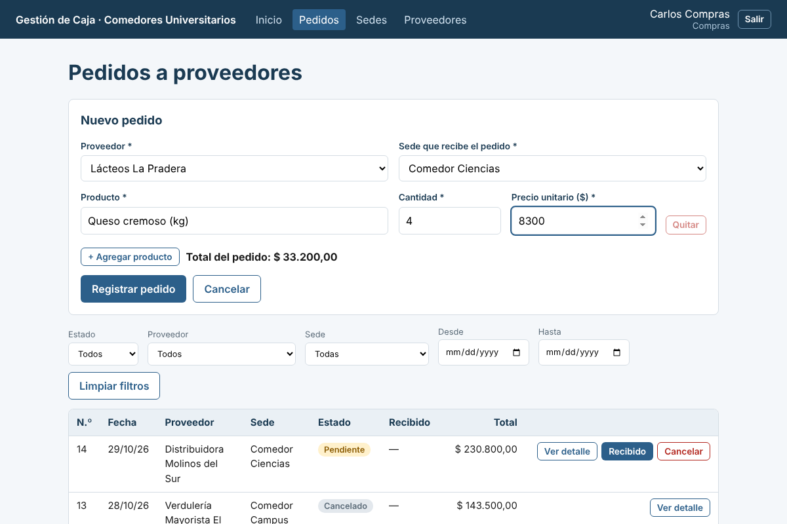

Cuando llega la mercadería, en la fila del pedido se toca **Recibido**. Si se anula, **Cancelar**. Ambos cambios piden confirmación y **no se pueden deshacer**: un pedido recibido o cancelado ya no cambia. Si hubo un error en un pedido pendiente, se cancela y se carga uno nuevo.

---

## 6. Administración

La administración puede hacer todo lo anterior en todas las sedes, y además:

### 6.1 Sedes

En **Sedes** se dan de alta, modifican y dan de baja los comedores (nombre, universidad y dirección). Una sede dada de baja no se borra: conserva su historial pero ya no se puede operar con ella. Los cajeros y compras ven el listado, sin poder modificarlo.

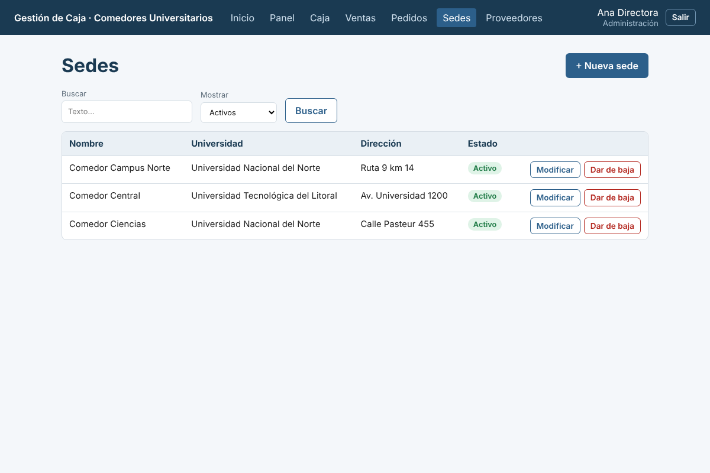

### 6.2 Panel consolidado

En **Panel** se ve de un vistazo cómo viene el negocio:

- **Período:** botones *Hoy*, *Últimos 7 días*, *Últimos 30 días* y *Todo el período*, o fechas a elección. También se puede mirar una sola sede.
- **Totales de toda la cadena:** ventas, pedidos y **resultado** (ventas menos pedidos; verde si es positivo y rojo si es negativo).
- **Ventas por medio de pago** y **pedidos por estado**.
- **Tabla por sede** y un **gráfico** que compara ventas y pedidos de cada comedor.

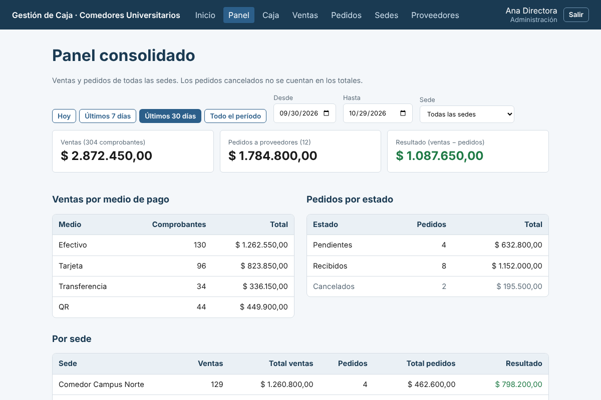

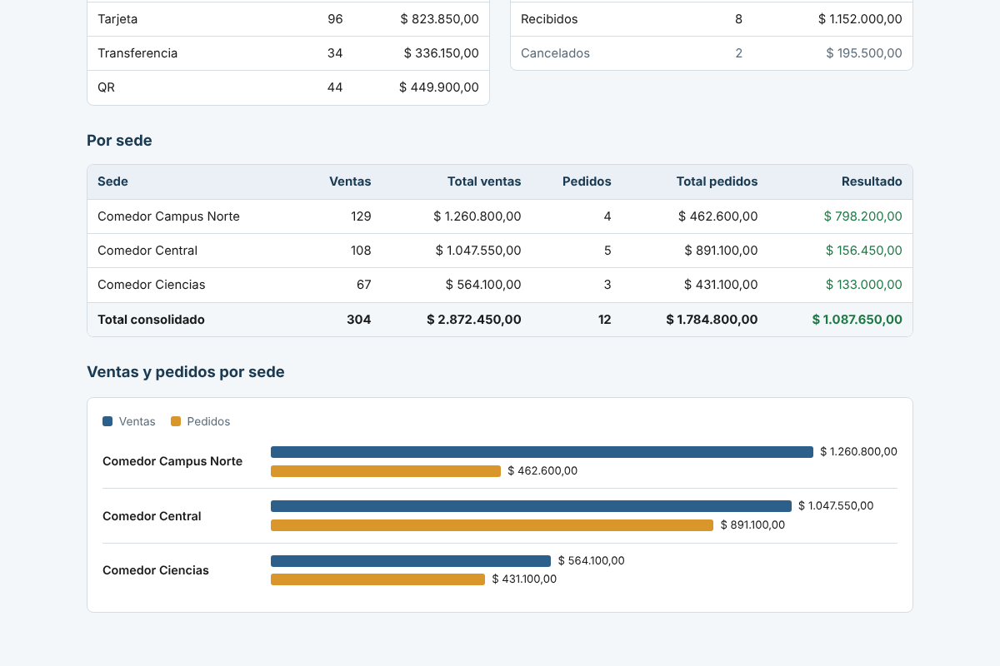

> Los pedidos **cancelados no se cuentan** en los totales (se muestran aparte en la tabla de estados).

---

## 7. Preguntas frecuentes

| Pregunta | Respuesta |
|---|---|
| No puedo cargar una venta: dice que no hay caja abierta | Hay que abrir la caja de la sede en **Caja** antes de vender. |
| Me equivoqué en una venta | Los comprobantes no se pueden modificar ni borrar desde la aplicación (son el respaldo del cierre). Avisar a la administración para que lo tenga en cuenta al revisar el cierre. |
| No me aparece una pantalla (por ejemplo Panel) | Cada rol ve solo lo suyo. Si hace falta otro permiso, pedirlo a la administración. |
| Dice "Sin acceso" | La persona entró a una dirección que no corresponde a su rol. Volver al **Inicio**. |
| La aplicación tarda mucho al ingresar | Es el servicio gratuito "despertando". Esperar hasta un minuto sin cerrar la página. |
| Me sacó de la sesión | La sesión venció o el usuario se dio de baja. Volver a ingresar. |
| Un proveedor o una sede no aparece en el formulario | Probablemente está dado de baja. Reactivarlo desde su listado (*Dados de baja* → **Reactivar**). |

## 8. Para quien administra el sistema

- **Usuarios, sedes y datos en general:** el panel de administración del sistema está en `<dirección del backend>/admin/` (la dirección del backend figura en [`04-Despliegue.md`](./04-Despliegue.md)). Se ingresa con el usuario administrador. Ahí se crean los usuarios y se les asigna el rol (administración, cajero o compras) y, a los cajeros, la sede.
- **Un cajero siempre necesita una sede asignada.** Sin ella no puede abrir la caja ni cargar ventas.
- **Datos de ejemplo:** para una demostración se pueden cargar con `database/datos_ejemplo.sql` (ver [`../database/README.md`](../database/README.md)). Usuarios de ejemplo, todos con la contraseña `Demo-1234`:

| Rol | Email |
|---|---|
| Administración | `admin@comedores.test` |
| Compras | `compras@comedores.test` |
| Cajero (Comedor Central) | `cajero.central@comedores.test` |
| Cajero (Campus Norte) | `cajero.norte@comedores.test` |
| Cajero (Ciencias, sin caja abierta) | `cajero.ciencias@comedores.test` |

  Esos usuarios son solo para pruebas: en un uso real hay que darlos de baja o cambiarles la contraseña.
